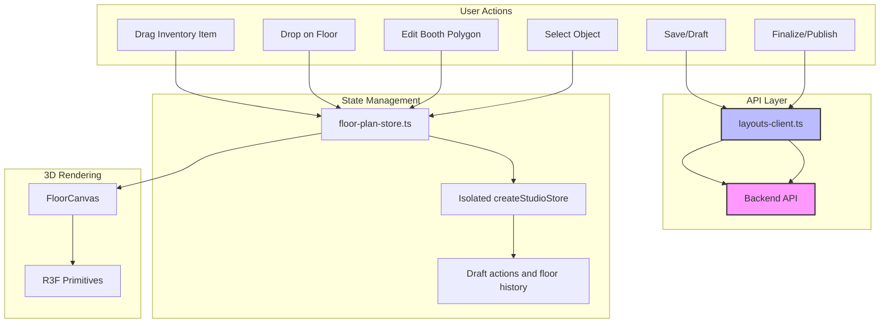

# Design Document: Admin Floor Plan Builder

## Restoration record and contract

This detailed document was recovered from Kiro local history (1,915 pre-rewrite lines), with its
file inventory corroborated by the Codex session history. The exact recovery is preserved in
`snapshots/kiro-before-rewrite/design.md`; the condensed replacement is preserved separately.
Original architectural topics, inventory detail and acceptance properties are retained. Targeted
corrections resolve contradictory examples rather than treating them as implementation guidance.

Requirements 1-12 keep their original IDs. Requirement 13 and the P01-P25 table in tasks.md cover
every supplied Demo parity TODO, including the two declined items and the requested port order.
The implementation record and evidence limits are in tasks.md and the feature README. Test execution remains deferred by
user request; illustrative code and future acceptance scenarios below are not evidence of passes.
Realistic procedural details remain a later phase. All phases prohibit external model loading.

### Implementation audit corrections — 15 October 2026

See [implementation-audit.md](implementation-audit.md) for the requirement mapping, corrected
deviations and evidence limits. Tasks 44 and 49 remain open. The unchanged backend publication
gate uses a bounding-box fallback for reserved procedural asset IDs; schema-valid serialization
does not make that fallback an exact polygon collider. Studio placement and Recast use exact
footprints; do not weaken `collidable` or change the backend to conceal this discrepancy.

Recalibration retains a finite, invertible optional `planarMatrix: [a,b,c,d]` in procedural metadata.
For non-booth objects it carries residual planar shear/reflection after metric axis lengths are
absorbed into dimensions/vertices. Rendering and `objectPoints` apply this matrix before ordinary
scale/yaw/translation; resize gestures invert it. Booth polygons instead absorb the complete
reprojection directly. This avoids replacing a calibrated parallelogram with its rectangular bounds.
Loaded natural image sizes are ephemeral, keyed by floor and image URL; a successful calibration
persists the size. Unknown metric-image sizes block calibration until the original image loads.

Existing POIs and portal entries are exposed as editable procedural reference markers. Their IDs
and ownership survive edits/deletion so canonical records are neither duplicated nor resurrected.
An imported portal marker retains its exact landing point and has no invented stair-body collision.
Connector companion creation preserves source recipe parameters; explicit disconnect/landing edits
use the initiating floor's guarded history. The target-landing form belongs to the staged object,
so Apply/Discard/undo restore it like other fields.

Legacy booth doors, physical feet dimensions and asset references survive unrelated edits. Stored
source transforms also map directional metadata. Publication issues have revision-scoped floor/object
links; loads, queued draft acknowledgements and publication use document epochs as well as revisions.
Inventory definitions now have a runtime Zod schema, and drawing/zone errors appear before Apply.

## Overview

### Subsequent booth refinement brief

The user's detailed rectangular/polygon booth description is implemented and documented in
`src/floor-plan-builder/booth-design.md`. It adds the optional `boothDesign` metadata contract,
shared modular/PBR renderer, layout/edge/roof/surface controls, generated signage and storage-door
animation. New recipes enforce the expressly requested clearances and construction limits; legacy
recipes keep their earlier acceptance. Studio navigation uses wall/column obstacles and walkable
interiors. This is a subsequent scoped update, not deletion of the restored plan or a completion
claim for backend tasks 44/49. The original snapshots remain unchanged.

The Admin Floor Plan Builder is a dedicated 3D floor planning interface for venue administrators. It enables creation, editing, and management of 3D booth layouts with polygon-shaped (non-rectangular) booths, drag-and-drop inventory management, and dynamic visual feedback. This feature extends the existing building schema and layout editor infrastructure while maintaining separation from visitor-facing views.

### Design Principles

1. **Extensibility**: Leverage existing `building-schema.ts` and layout editor patterns
2. **Backend Compatibility**: Use existing `/api/events/:eventId/layout` and `/api/events/:eventId/layout/draft` endpoints
3. **Schema Alignment**: Compose the existing wire types through an isolated metadata adapter without extending server/shared schemas
4. **Consistency**: Follow existing code organization (features/building, features/layout-editor)
5. **Performance**: Retain the 50+ object / 60 FPS target as a measured goal with a declared viewport, DPR and hardware, not an established universal result
6. **Procedural Rendering**: Use R3F primitives in all phases; defer realistic procedural detail to later phases
7. **Data Persistence**: Auto-save with debouncing and error recovery
8. **Shortcut Parity**: Preserve all existing keyboard shortcuts from demo

## Architecture

### Backend API Integration

The Admin Floor Plan Builder uses existing backend API endpoints from `src/features/building/api/layouts-client.ts`:

**Existing Endpoints:**
- `PUT /api/events/:eventId/layout` - Save/publish layout
  - Returns: `{ saved: boolean }`
  - Header: `X-Venue-Version` for optimistic concurrency control
  - Authorization: `venueAuthorizationHeaders()`
  
- `PUT /api/events/:eventId/layout/draft` - Save draft layout
  - Returns: `{ saved: boolean }`
  - Authorization: `venueAuthorizationHeaders()`
  
- `GET /api/events/:eventId/layout` - Load published layout
  - Returns: BuildingLayout
  - Header: `X-Venue-Version` in response
  
- `GET /api/events/:eventId/layout/draft` - Load draft layout
  - Returns: BuildingLayout | null
  - Authorization: `venueAuthorizationHeaders()`

**Version Management:**
- `loadedVersions` Map tracks accepted revision for each event
- `responseVersions` WeakMap maps layouts to their version metadata
- Draft saves do not advance publication versions or send the publication-version header
- These maps are private to the existing client; the studio calls exported functions only
- Call acceptLayoutVersion only when adopting the exact fetched published object; saveLayout owns advancement after publication
- Layout loads use generation counter to ignore stale responses

### High-Level Structure

```
src/
├── floor-plan-builder/            # Entire new frontend stays in this isolated subtree
│   ├── api/                      # API clients (reuse building API)
│   │   └── index.ts              # Re-exports from building/api
│   ├── components/               # UI Components
│   │   ├── AdminFloorPlanPage.tsx
│   │   ├── FloorCanvas.tsx       # Main 3D canvas component
│   │   ├── InventorySidebar.tsx  # Drag-and-drop inventory sidebar
│   │   ├── BoothEditor.tsx       # Polygon booth editor
│   │   └── FloorSelector.tsx
│   ├── hooks/                    # Custom hooks
│   │   ├── use-floor-manager.ts
│   │   ├── use-inventory-drag.ts
│   │   └── use-booth-editor.ts
│   ├── model/                    # State management and logic
│   │   ├── floor-plan-store.ts   # Zustand store for floor plan state
│   │   ├── object-types.ts       # Object type definitions
│   │   ├── validation.ts         # Validation logic
│   │   └── utils.ts              # Utility functions
│   └── types/                    # TypeScript types
│       └── floor-plan-types.ts
└── features/building/
    └── api/                      # Reused API clients
        ├── layouts-client.ts     # Backend API integration
        └── dto.ts                # Request/response schemas
```

### Component Hierarchy

```
AdminFloorPlanPage
├── FloorSelector (top bar)
├── InventorySidebar (left sidebar)
│   ├── InventoryCategory (booths, stairs, tents, amenities)
│   │   └── InventoryItem (draggable)
├── MainCanvasContainer
│   └── FloorCanvas (R3F Canvas)
│       ├── FloorBackground
│       ├── WalkableZones
│       ├── BoothInstances
│       │   └── Booth (polygon-shaped)
│       ├── OtherObjects
│       │   ├── Stairs
│       │   ├── Tents
│       │   ├── Washrooms
│       │   ├── KidsZone
│       │   └── Avatars (R3F primitives: cylinder for body, box for head)
│       ├── DragGhost (during drag operations)
│       └── SelectionHighlight (selected object)
└── ValidationPanel (bottom)
    ├── ErrorList
    ├── ValidationSummary
    └── SaveStatus
```

### Data Flow



## Components and Interfaces

### API Client Integration

**Reusing Existing Building API**

The Admin Floor Plan Builder reuses the API clients from `src/features/building/api/`:

```typescript
// src/floor-plan-builder/api/index.ts (conceptual facade; current implementation uses persistence.ts)
export {
  getLayout,
  saveLayout,
  getLayoutDraft,
  saveLayoutDraft,
  acceptedLayoutVersion,
  acceptLayoutVersion,
} from '@/features/building/api/layouts-client.ts';

// Use the actual exported client/schema types; do not invent DTO type exports.
```

**API Function Signatures:**

```typescript
// Get published layout
export async function getLayout(
  eventId: string,
  config?: AxiosRequestConfig,
): Promise<Result<BuildingLayout, ApiError>>

// Save/publish layout
export async function saveLayout(
  eventId: string,
  layout: BuildingLayout,
): Promise<Result<{ saved: boolean }, ApiError>>

// Get draft layout
export function getLayoutDraft(
  eventId: string,
  config?: AxiosRequestConfig,
): Promise<Result<BuildingLayout | null, ApiError>>

// Save draft layout
export function saveLayoutDraft(
  eventId: string,
  layout: BuildingLayout,
): Promise<Result<{ saved: boolean }, ApiError>>

// Version management
export function acceptedLayoutVersion(eventId: string): number
export function acceptLayoutVersion(eventId: string, layout: BuildingLayout): void
```

**Usage in Components:**

```typescript
// Auto-save draft
async function autoSaveDraft(layout: BuildingLayout) {
  const result = await saveLayoutDraft(eventId, layout);
  if (result.isOk()) {
    // Draft saved successfully
    // The backend validates and stores the layout
  } else {
    // Handle error - network failure, version conflict, etc.
    console.error('Draft save failed:', result.error);
  }
}

// Finalize/publish layout
async function finalizeLayout(layout: BuildingLayout) {
  // The existing client reads the accepted version and advances it on success.
  const result = await saveLayout(eventId, layout);
  if (result.isOk() && result.value.saved) {
    // Layout published successfully. Never reaccept an old fetched layout here.
  } else {
    // Handle error or no change
  }
}
```

### Polygon Geometry Specification

**Storage Model:**

The polygon geometry uses unique vertices with implicit closure:

```typescript
// Store distinct vertices; the final edge to the first is implicit.
// Example: square with vertices at corners
type Polygon = [number, number][]; // Array of [x, z] coordinates in meters

// Valid polygon (implicitly closed square):
const validPolygon: Polygon = [
  [0, 0],  // vertex 0
  [5, 0],  // vertex 1
  [5, 5],  // vertex 2
  [0, 5],  // vertex 3
];

// Validation rules:
// 1. Minimum 3 distinct finite vertices, with no stored closing vertex
// 2. The final edge joins the last vertex to the first for geometry operations
// 3. Must be simple (no self-intersections)
// 4. Must have positive area (>= 0.01 square meters)
// 5. No repeated vertices, including a duplicated first/last vertex
```

**Coordinate Systems:**

```typescript
// Source Coordinates (pixels) - from floor image
interface SourceCoordinates {
  units: 'pixels';
  metersPerPixel: number; // calibration factor
  origin: [number, number]; // image origin in source units
  // Optional basis matrix for non-aligned coordinate systems
  basis?: [number, number, number, number];
}

// World Meters - for 3D rendering and collision detection
interface WorldCoordinates {
  units: 'meters';
}

// Conversion utilities from src/features/building/model/floor-coordinates.ts:
export function sourceToMetres(
  point: [number, number],
  calibration?: SourceCoordinates
): [number, number] {
  // Converts source coordinates to world meters
  // Handles pixel-to-meter conversion via metersPerPixel
  // Applies origin offset
  // Uses basis matrix if present for rotated coordinate systems
}

export function metresToSource(
  point: [number, number],
  calibration?: SourceCoordinates
): [number, number] {
  // Converts world meters to source coordinates
  // Inverse operation of sourceToMetres
}
```

**Rotation and Scaling:**

```typescript
// Booth/Instance rotation (yaw)
interface Rotatable {
  yawRadians: number; // Rotation around Y-axis in radians
  // Use Three.js Y-axis yaw consistently with transformFootprint and picking.
  // 0 radians = facing +Z direction
}

// Scaling
interface Scalable {
  scale: [number, number, number]; // [x, y, z] scale factors
  // 1.0 = original size
  // >1.0 = larger
  // <1.0 = smaller
}
```

**Resize Behavior:**

```typescript
// When resizing a polygon:
// 1. Calculate new vertices based on resize handles
// 2. Validate the new polygon (simple, distinct vertices, implicit closure, positive area)
// 3. Update position to maintain center point if resizing around center
// 4. Preserve aspect ratio if shift key is held
// 5. Snap to grid if snap is enabled

function resizePolygon(
  polygon: Polygon,
  resizeHandle: number, // Index of handle being dragged
  newPosition: [number, number],
  options?: {
    preserveCenter?: boolean;
    preserveAspect?: boolean;
    snap?: number; // Snap to grid size in meters
  }
): Polygon {
  // Implementation
}
```

## Data Models

### Core TypeScript Interfaces (floor-plan-types.ts)

**Object Type Definitions**

These interfaces retain the original conceptual object families. Production types are inferred
from the feature schemas in `model/types.ts`; this section is not a second independently maintained
wire schema. The editor now retains stair/tent/material/signage parameters in its inferred model. `assetId`/`url`
below represent legacy identity only; generated assetId envelopes belong to the adapter. Editing
flags, originalPolygon and history are ephemeral and never serialized as instance metadata.

```typescript
// Object types supported by the floor plan builder
export const FLOOR_PLAN_OBJECT_TYPES = [
  'booth',
  'stairs',
  'tent',
  'washroom',
  'kids-zone',
  'avatar',
  'entrance',
] as const;

export type FloorPlanObjectType = (typeof FLOOR_PLAN_OBJECT_TYPES)[number];

// Editor object definition. The adapter emits floorAuthoringSchema.instances separately.
export interface FloorPlanObject {
  id: string;
  type: FloorPlanObjectType;
  position: [number, number]; // x, z in meters (world coordinates)
  yawRadians: number;
  scale: [number, number, number];
  floorId: string;
  // Optional legacy identity; the adapter generates the required procedural wire assetId.
  assetId?: string;
  url?: string;
  dimensions: [number, number, number]; // Required by backend schema
  collidable: boolean; // Required by backend schema
}

// Polygonal booth - synchronizes canonical room data through the adapter
export interface BoothObject extends FloorPlanObject {
  type: 'booth';
  polygon: [number, number][]; // Array of unique vertices with implicit closure
  originalPolygon: [number, number][]; // Ephemeral editor preview, not persisted metadata
  isEditing: boolean;
  isPreview: boolean;
}

// Stairs object - represents multi-step staircase
export interface StairsObject extends FloorPlanObject {
  type: 'stairs';
  steps: number;
  tread: number; // Depth of each step in meters
  rise: number;  // Height of each step in meters
  connectsFloorIds: string[]; // At least two separately positioned floor landings
  width: number;
}

// Tent object - represents different tent styles
export interface TentObject extends FloorPlanObject {
  type: 'tent';
  width: number;  // Base width in meters
  depth: number;  // Base depth in meters
  height: number; // Peak height in meters
  style: 'barn' | 'gazebo' | 'marquee';
}

// Amenity object - washroom, kids zone, entrance, avatar
export interface AmenityObject extends FloorPlanObject {
  type: 'washroom' | 'kids-zone' | 'entrance' | 'avatar';
  label: string;
  gender?: 'men' | 'women' | 'unisex'; // Only for washrooms
}
```

**State Management Types**

The state shape below describes responsibilities rather than the exact current store field names.
`layout` is the encoded wire view of the applied metric document, not an old-editor store reference.
The draft/saved-step separation is specified under Keyboard Shortcuts Integration and task 50.

```typescript
// Floor plan state
export interface FloorPlanState {
  layout: BuildingLayout;
  currentFloorId: string;
  selectedObjectId: string | null;
  isDragActive: boolean;
  dragInventory: InventoryDrag | null;
  dragPosition: [number, number] | null;
  isDirty: boolean;
  lastSavedAt: Date | null;
  validationErrors: FloorPlanValidationError[];
  unsavedChanges: boolean;
  // Per-floor undo/redo stacks
  floorHistory: Record<string, HistoryState>;
}

// Per-floor history state
export interface HistoryState {
  undoStack: PlanFloor[];
  redoStack: PlanFloor[];
}

// Validation error
export interface FloorPlanValidationError {
  id: string;
  type: 'collision' | 'invalid-polygon' | 'missing-field' | 'network';
  message: string;
  relatedIds: string[];
  severity: 'error' | 'warning';
}
```

### Zod Schemas

**Object schemas and the unchanged wire schema**

Editor schemas validate procedural recipes and metadata. They do not extend the backend instance
schema: the server's parse strips unknown instance keys. The adapter described below preserves
metadata in a reserved assetId and emits the existing required wire fields.

The implementation uses a single recipe-enum object schema in model/types.ts, including tent/stair,
material, signage, preset and group metadata with defaults for older envelopes. The following
flat-union example remains a conceptual alternative; do not maintain a second production schema.

~~~typescript
import { z } from 'zod';
import { finiteNumberSchema, point2Schema } from '@/types/spatial.ts';
import { buildingLayoutSchema } from '@/features/building/model/building-schema.ts';
import { isSimplePolygon, signedArea } from '@/utils/geometry/polygon.ts';

const positive = finiteNumberSchema.positive().max(1000);
const boundedText = z.string().max(2048);

export const polygonSchema = z.array(point2Schema)
  .min(3).max(256)
  .refine(isSimplePolygon, 'Use distinct vertices and no self-intersections.')
  .refine((points) => Math.abs(signedArea(points)) >= 0.01, 'Area must be at least 0.01 m².');

const objectBaseSchema = z.object({
  id: z.string().min(1).max(256),
  floorId: z.string().min(1),
  name: boundedText,
  position: point2Schema, // metric X/Z, not persisted source pixels
  yawRadians: finiteNumberSchema,
  scale: z.tuple([positive, positive, positive]),
  dimensions: z.tuple([positive, positive, positive]),
  collidable: z.boolean(),
  polygon: polygonSchema, // local metric footprint, implicit closure
  colorMode: z.enum(['surface', 'explicit']),
  color: z.string().regex(/^#[0-9a-f]{6}$/i),
});

export const boothSchema = objectBaseSchema.extend({
  type: z.literal('booth'),
  boothNumber: boundedText,
  price: finiteNumberSchema.nonnegative(),
  status: z.enum(['AVAILABLE', 'HOLD', 'BOOKED', 'UNAVAILABLE']),
  company: boundedText,
  boothType: boundedText,
  youtubeLink: boundedText,
  gate: z.enum(['front', 'back', 'left', 'right']),
  tags: boundedText,
  contactName: boundedText,
  contactEmail: boundedText,
  contactPhone: boundedText,
});

export const stairsSchema = objectBaseSchema.extend({
  type: z.literal('stairs'),
  steps: z.number().int().min(1).max(100),
  // Derive tread = dimensions[2] / steps and rise = dimensions[1] / steps.
  // If independent controls are offered, validate that their products match dimensions.
  connectsFloorIds: z.array(z.string().min(1)).min(2).max(20),
  portalId: boundedText,
});

export const tentSchema = objectBaseSchema.extend({
  type: z.literal('tent'),
  style: z.enum(['barn', 'gazebo', 'marquee']),
  overhang: finiteNumberSchema.nonnegative(),
  polePositions: z.array(point2Schema).max(32),
  canopyMaterial: boundedText,
});

export const washroomSchema = objectBaseSchema.extend({
  type: z.literal('washroom'),
  gender: z.enum(['men', 'women', 'unisex']),
  label: boundedText,
});
export const kidsZoneSchema = objectBaseSchema.extend({
  type: z.literal('kids-zone'), label: boundedText,
});
export const avatarSchema = objectBaseSchema.extend({
  type: z.literal('avatar'), label: boundedText,
});
export const entranceSchema = objectBaseSchema.extend({
  type: z.literal('entrance'), label: boundedText,
});

// Every option is a ZodObject with its own literal discriminator.
export const floorPlanObjectSchema = z.discriminatedUnion('type', [
  boothSchema, stairsSchema, tentSchema,
  washroomSchema, kidsZoneSchema, avatarSchema, entranceSchema,
]);
export type FloorPlanObject = z.infer<typeof floorPlanObjectSchema>;

// This separate parse is the transport boundary, not an editor-schema substitution.
export const parseWireLayout = (input: unknown) => buildingLayoutSchema.parse(input);
~~~

Do not import private point/number/URL/reference helpers from building-schema.ts. Import exported
spatial helpers from types/spatial.ts. Do not place an already constructed amenity union inside the
outer discriminated union. Do not serialize history, selection, ghost or isEditing/isPreview flags.

### Metadata serialization and ownership

The reserved format is fpb:v1: followed by URI-encoded JSON for the validated PlanObject metadata.
The current adapter encodes the full validated object, including geometry and metadata; wire
position/yaw/scale/dimensions/collidable take precedence during decoding. Bound text/vertex arrays
and reject envelopes over 65,536 encoded characters. This is a temporary backend-compatible
adapter, not a GLB URL or a new backend asset loader.

1. Decode published/draft JSON through the actual buildingLayoutSchema.
2. Decode only reserved recipe prefixes; reject malformed/unsupported reserved payloads visibly.
3. Convert normal instance transforms from floor source coordinates to metric editor coordinates.
4. Reconcile matching Room geometry/label/price as canonical when the old editor has modified them.
5. Preserve unknown nonreserved legacy instances, rooms, POIs, walls, obstacles and portals.
6. On encode, emit reserved instances plus synchronized booth Rooms, POIs, zones and portal entries.
7. Parse the encoded result through buildingLayoutSchema before sending or replacing applied state.
8. Retain a separate event by default because existing visitor renderers do not understand recipes.

A booth Room and its instance share one entity ID. Recipe identity differs from instance identity;
two placements of the same recipe have distinct UUIDs. Generated POI/portal ownership is explicit.
Removing an owned visual entity removes its owned canonical records only. A removed floor prunes
portal connections/landings atomically; undo must not revive unrelated records from another floor.

The all-editable-fields round trip is encode -> real wire schema parse -> decode, not equality
before parsing. Publication must not be called successful merely because the adapter produced JSON.

### Validation Constants

```typescript
export const VALIDATION_RULES = {
  // Polygon validation
  minVertices: 3,
  maxVertices: 256,
  minArea: 0.01, // square meters
  
  // Object placement
  minSpacing: 0, // touching edges allowed; exact positive-area overlap is blocked
  maxObjectsPerFloor: 200, // original profiling budget, not an enforced product limit
  
  // Dimensions
  minBoothSize: [0.1, 0.1], // implemented inventory limits, meters
  maxBoothSize: [1000.0, 1000.0], // polygon area must also be at least 0.01 m²
  
  // Performance
  maxTotalVertices: 10000,
  maxDrawCalls: 100,
};
```

## Correctness Properties

*A property is a characteristic or behavior that should hold true across all valid executions of a system-essentially, a formal statement about what the system should do. Properties serve as the bridge between human-readable specifications and machine-verifiable correctness guarantees.*

### Property 1: Polygon validity preservation

*For any* applied booth object, its polygon must be simple, have distinct finite vertices with implicit closure, and have metric area at least 0.01 m². Invalid temporary input remains editable without replacing the valid document.

**Validates: Requirements 3.1, 3.3, 3.9**

### Property 2: Object placement collision avoidance

*For any* applied collidable objects on a floor, their transformed polygons must have no positive-area overlap and stay within the boundary/outside blocked geometry. Broad-phase boxes may overlap when concave polygons do not; edge contact is allowed.

**Validates: Requirements 2.2, 8.6, 8.7**

### Property 3: Validation accuracy

*For any* candidate operation, the documented schema/geometry/readiness rules determine acceptance and related field/entity errors. Rejected candidates preserve the previous applied state and expose actionable correction feedback.

**Validates: Requirements 8.1-8.11**

### Property 4: Save/load data integrity (Round-trip)

*For any* valid floor plan layout, saving to the backend and reloading should produce an equivalent layout with all data preserved.

**Validates: Requirements 9.11-9.14**

### Property 5: Drag-and-drop object creation

*For any* inventory item dropped on a floor, a new object should be created with the correct type, position, and default properties, and the object count should increase by exactly one.

**Validates: Requirements 2.1-2.6, 11.10**

### Property 6: Undo/redo consistency

*For any* applied floor edit, saved-step undo restores the fields/records owned by that floor's step without reverting unrelated work on other floors. Explicit connector transactions include only their related landing changes, with guards against overwriting later edits. Temporary draft undo/redo and pending removals remain within their own Apply/Discard boundary.

**Validates: Requirements 7.10-7.11, 13.17, 13.22-13.23**

### Property 7: Selection persistence

*For any* selected object, the selection should persist through all state updates that don't explicitly change the selection, and deselecting should clear the selection without side effects.

**Validates: Requirements 13.1-13.2, 13.14, 13.23**

## Error Handling

### Validation Error Handling

**Polygon validation errors**

~~~typescript
import { polygonSchema, type PlanObject, type PlanFloor } from '../model/types.ts';
import { placementError } from '../model/geometry.ts';

export function validateBoothPolygon(points: [number, number][]): string | null {
  const result = polygonSchema.safeParse(points);
  return result.success ? null : result.error.issues.map((issue) => issue.message).join(' ');
}
export function validateObjectPlacement(object: PlanObject, floor: PlanFloor): string | null {
  return placementError(object, floor);
}
~~~

Unique vertices and implicit closure are mandatory. Concavity is allowed. A repeated final vertex
is a duplicate, not proof that the polygon is closed. Preserve invalid input for correction and
highlight the offending vertices/fields rather than losing the previous valid document.

**Object placement validation errors**

Use metric local footprints transformed by scale, yaw and position. Bounds provide a broad phase
only; exact polygons determine overlap. Edge touching is allowed. Check full containment in concave
floor boundaries, blocked zones, legacy obstacle polygons and authored wall extents. Room/instance
representations of one booth count once. Noncollidable references and walkable zones can overlap.

placementError includes calibrated legacy obstacles and authored wall boxes, with vertical opening
filtering through authoredWallBoxes. Preview, Apply, Finalize and Recast use the same transformed
footprints. A center-distance heuristic or a fixed one-meter radius is not an acceptable substitute.

### Network Error Handling

**Existing-client contract**

Use getLayout/getLayoutDraft/saveLayoutDraft/saveLayout from layouts-client.ts. Do not create
/api/floor-plans endpoints, duplicate the transport, or access private version maps. Protected
operations reuse existing venue authorization; the published read keeps existing client behavior.

~~~typescript
import {
  getLayout, getLayoutDraft, saveLayoutDraft, saveLayout, acceptLayoutVersion,
} from '@/features/building/api/layouts-client.ts';

// Adopt a fetched published document only after dirty-work/generation guards pass.
async function adoptPublished(eventId: string, adopt: (layout: BuildingLayout) => void) {
  const result = await getLayout(eventId);
  if (result.isErr()) return result;
  acceptLayoutVersion(eventId, result.value);
  adopt(result.value);
  return result;
}

// Drafts do not advance publication versions.
const saveDraft = (eventId: string, layout: BuildingLayout) =>
  saveLayoutDraft(eventId, layout);

// saveLayout reads/advances the accepted version. Do not call acceptLayoutVersion here.
const publish = (eventId: string, layout: BuildingLayout) =>
  saveLayout(eventId, layout);
~~~

**Error recovery strategy**

Network/auth errors retain the local document, dirty revision and event-scoped recovery. Show an
explicit Retry save or Sign in action. A 409 publication conflict offers comparison/reload with
unsaved-work protection. A 428 requires accepting the published version first. Publication is never
blindly retried/rebased. Do not reload over dirty state or mark an unacknowledged save as Saved.

### User Feedback for Errors

**Error Display Component**

```typescript
function ErrorDisplay({ errors }: { errors: FloorPlanValidationError[] }) {
  if (errors.length === 0) {
    return null;
  }
  
  return (
    <div className="bg-red-50 border border-red-200 rounded-lg p-4">
      <h3 className="text-red-800 font-semibold mb-2">
        {errors.length} Validation Error{errors.length > 1 ? 's' : ''}
      </h3>
      <ul className="text-red-700 text-sm">
        {errors.map((error) => (
          <li key={error.id} className="mb-1">
            {error.severity === 'error' ? '⚠️' : '💡'} {error.message}
          </li>
        ))}
      </ul>
    </div>
  );
}
```

**Validation Summary**

```typescript
function ValidationSummary({ errors }: { errors: FloorPlanValidationError[] }) {
  const errorCount = errors.filter(e => e.severity === 'error').length;
  const warningCount = errors.filter(e => e.severity === 'warning').length;
  
  if (errorCount === 0 && warningCount === 0) {
    return <span className="text-green-600">No errors</span>;
  }
  
  return (
    <div className="flex items-center space-x-4">
      {errorCount > 0 && (
        <span className="text-red-600">⚠️ {errorCount} error{errorCount > 1 ? 's' : ''}</span>
      )}
      {warningCount > 0 && (
        <span className="text-yellow-600">💡 {warningCount} warning{warningCount > 1 ? 's' : ''}</span>
      )}
    </div>
  );
}
```

### Error Types and Recovery

| Error Type | Severity | User Action | System Recovery |
|------------|----------|-------------|-----------------|
| Collision | Error | Reposition object | Auto-highlights conflicting objects |
| Invalid Polygon | Error | Edit vertices | Shows error on invalid vertices |
| Missing Field | Error | Fill required fields | Highlights missing fields |
| Network | Error | Retry save | Local cache preserved for retry |
| Serialization | Error | Report bug | Logs detailed error for debugging |

### Validation Pipeline

Structural validation and physical readiness are distinct. Drafts may contain a structurally valid
layout whose calibration or connector setup is unfinished; publication additionally requires the
existing publishReadiness checks and complete physical placement.

1. Validate edited metadata, finite/positive values, polygon uniqueness/area and booth numbering.
2. Validate transformed placement against boundary, blocked geometry and collidable entities.
3. Validate zone shape/type/label and floor calibration without losing an invalid temporary form.
4. Encode through the ownership-preserving adapter and parse through buildingLayoutSchema.
5. Before Finalize, run publishReadiness, all managed-object placement checks, and paired landings.
6. Deduplicate issues, retain related entity/field IDs, and reveal the affected editor section.

Persisted pixel polygons must not be checked against a square-meter area threshold before conversion.
The UI now has a structured placement summary, invalid numeric/name fields, numbered invalid
vertices and conflicting-object highlights. Invalid drafts keep the applied scene intact; a Canvas
error boundary and context-loss recovery retain the document. Full interaction/accessibility
verification remains deferred and must not be inferred from the compiler/build results.

### Keyboard Shortcuts Integration

**Reference source and meanings**

The source of truth is demo/src/main.js: handleAdminShortcut, cycleBoothPresetShortcut,
cyclePoiPlacementShortcut, plus the demo editor modules. The old React FloorPlanEditor handler
is not interchangeable with this contract. Requirement 10 preserves all original numbered criteria,
corrected to match the demo; Requirement 13.13 tracks the supplied parity TODO.

| Input | Command | Required detail |
|---|---|---|
| Shift+S | Apply dirty editor/drawing state | Not backend save/reload; applies floor/object/zone/removal draft |
| Shift+R | Booth resize | Focus corresponding editor and expose handles/numeric controls |
| Shift+M | Move selected entity | Last-selected booth/POI targeting |
| Shift+D | Duplicate placement | New ID only on Apply/drop; original remains intact |
| Shift+B | Rectangle booth drawing | Keep preset and freeform tools visible together |
| Shift+P | Polygon booth drawing | Unique vertices, Enter/double-click/right-click finish |
| Shift+T | Cycle demo booth preset | Actual chip order/default fields, not rectangle/polygon toggle |
| Shift+I | Cycle stair/entrance POI | Independent POI cursor, rotation and connection editing |
| Shift+Z | Rectangle walkable zone | Never fall through from Ctrl/Cmd+Shift+Z |
| Shift+X | Arm remove | Wait for target click, then pending-remove preview |
| Ctrl/Cmd+Z | Draft undo | Active floor only; preserves other-floor edits |
| Ctrl/Cmd+Shift+Z | Draft redo | Return immediately before Shift-letter resolution |
| Escape | Cancel draft/gesture/removal | Restore preview-hidden objects and orbit ownership |
| Enter/double-click/right-click | Finish polygon | No repeated final vertex; invalid draft remains editable |

**Focus and modifier guards**

Ignore defaultPrevented/repeated events, Alt or conflicting Ctrl/Meta combinations, input, textarea,
select, contenteditable and shadcn text/combobox/spinbutton editing. Recognize contenteditable
ancestors, not only the immediate event target. Every command also has labelled DOM controls.
Reveal/focus its corresponding expanded section rather than requiring users to locate it manually.

**POI move/duplicate and pointer ownership**

One active gesture owns pointer capture and temporary state. Duplicate previews keep the original
object/POI, preserve recipe metadata, and commit a new UUID only after valid Apply/drop. For linked
connectors, do not accidentally clone the original portal identity into an independent duplicate.
Cancel, lost capture, outside drop and blur recover controls without document/history changes.

Click-vs-drag disambiguation prevents pointer-up followed by click from triggering a second place,
select or apply. Tool changes must not overwrite another pending form/removal draft. Keyboard-only
position/rotation/dimension controls provide equivalents to all in-canvas operations.

**Floor-change guards and history**

The demo's canChangeFloor checks hasDraftHistory, which includes both undo and redo draft entries.
Keep temporary draft history separate from applied saved-step history and server dirty revisions.
A successful backend autosave alone must not clear an unfinished form or draft redo entry.

~~~typescript
import type { PlanFloor } from '../model/types.ts';

interface FloorSavedHistory {
  undo: PlanFloor[];
  redo: PlanFloor[];
}
interface FloorDraftHistory {
  undo: DraftAction[];
  redo: DraftAction[];
}
interface DraftAction {
  label: string;
  applyPreview: () => void;
  revertPreview: () => void;
}
type PendingRemoval = { kind: 'object' | 'zone'; id: string } | null;
~~~

Saved history snapshots contain active-floor state, never a whole BuildingLayout per floor. Adapter
ownership reconciles related Room/POI/Portal records when snapshots change. Coupled connector/floor
operations require explicit atomic handling; they must not secretly rewind unrelated floors.

Draft edits and pending removals block switches/reload until Apply/Save or Discard. When the draft
boundary resolves, clear that draft scope, not all saved history. Keep history bounded and clear
redo only for a new branch. The existing store has floor snapshots but not this full separation.

**Pending-remove workflow**

1. Shift+X arms deletion; Escape cancels the armed mode.
2. Target click stages its ID and hides its render/directory preview, with "Apply to save".
3. Canonical state and persisted snapshots remain unchanged until Apply.
4. Apply commits removal plus owned Room/POI/Portal cleanup as one transaction.
5. Discard/Escape restores target visibility and selection. Invalid or interrupted Apply keeps
   the preview correctable and the original document recoverable.

Zone point-undo removes only the last drawn point and leaves its remaining shape/tool active. It
does not create a committed transaction, invoke whole-floor undo or change save revision identity.

### Real-time Validation Feedback

The studio subscribes to its own document/revision state. It does not call the existing editor's
useLayoutStore/useWorldStore. During a gesture, validate only the temporary candidate for responsive
feedback; run whole-document structural/readiness checks at Apply/save/finalize boundaries.

Keep issue IDs and related entity IDs stable so an invalid vertex, conflicting booth, blocked wall
or missing field can be revealed in the correct editor. Draft edits remain separate from the last
valid document. Changes to display preferences must not create geometry history or autosave writes.

### Procedural-Only Rendering (Phase 1)

**R3F Primitives for All Objects**

The Admin Floor Plan Builder uses procedural R3F geometry in all phases. Detailed realism is later work; no Blender, GLB or GLTF loading is permitted in this new frontend.

**Object types and their procedural representations**

All coordinates below are local metric coordinates. A parent group owns metric position, floor
elevation, yaw and scale. Geometry starts at local Y=0; mesh centers must be offset by half-height.
Native R3F JSX owns geometry/material lifetime. Shape construction is memoized; never allocate a
new disposable BufferGeometry on every render or use Three classes as React components.

The example shows corrected floor-contact solids, not a completed visual design or a new asset
pipeline. Production also needs the inventory/metadata parameters, picking, ghost material,
selection outline and related validation described elsewhere in this document.

~~~tsx
import { useMemo, type ReactNode } from 'react';
import { Shape } from 'three';
import type { PlanObject } from '../model/types.ts';

function SolidBox({ size, at, color }: {
  size: [number, number, number];
  at: [number, number, number];
  color: string;
}) {
  return (
    <mesh position={at} castShadow receiveShadow>
      <boxGeometry args={size} />
      <meshStandardMaterial color={color} roughness={0.7} />
    </mesh>
  );
}

function FloorContact({ object, floorHeight, children }: {
  object: PlanObject; floorHeight: number; children: ReactNode;
}) {
  return (
    <group
      position={[object.position[0], floorHeight, object.position[1]]}
      rotation={[0, object.yawRadians, 0]}
      scale={object.scale}
    >
      {children}
    </group>
  );
}

function BoothSurface({ object, color }: { object: PlanObject; color: string }) {
  const shape = useMemo(() => {
    const result = new Shape();
    object.polygon.forEach(([x, z], index) => {
      if (index === 0) result.moveTo(x, -z);
      else result.lineTo(x, -z);
    });
    result.closePath(); // rendering closes the edge; storage keeps distinct vertices
    return result;
  }, [object.polygon]);
  return (
    <mesh rotation={[-Math.PI / 2, 0, 0]} castShadow receiveShadow>
      <extrudeGeometry args={[shape, { depth: 0.08, bevelEnabled: false }]} />
      <meshStandardMaterial color={color} roughness={0.75} />
    </mesh>
  );
}

function StairSolid({ object, color }: { object: PlanObject; color: string }) {
  const [width, height, depth] = object.dimensions;
  const tread = depth / object.steps;
  return (
    <group>
      {Array.from({ length: object.steps }, (_, index) => {
        const rise = ((index + 1) * height) / object.steps;
        return (
          <SolidBox key={index} color={color}
            size={[width, rise, tread]}
            at={[0, rise / 2, -depth / 2 + (index + 0.5) * tread]} />
        );
      })}
    </group>
  );
}

function BarnCanopy({ object, color }: { object: PlanObject; color: string }) {
  const [width, height, depth] = object.dimensions;
  const eaves = height * 0.72;
  const roof = useMemo(() => {
    const section = new Shape();
    section.moveTo(-width / 2, eaves);
    section.lineTo(0, height);
    section.lineTo(width / 2, eaves);
    section.closePath();
    return section;
  }, [width, height, eaves]);
  return (
    <group>
      {[-1, 1].flatMap((x) => [-1, 1].map((z) => (
        <SolidBox key={String(x) + ':' + String(z)} color="#bab3a2"
          size={[0.1, eaves, 0.1]} at={[x * width / 2, eaves / 2, z * depth / 2]} />
      )))}
      <mesh position={[0, 0, -depth / 2]} castShadow>
        <extrudeGeometry args={[roof, { depth, bevelEnabled: false }]} />
        <meshStandardMaterial color={color} roughness={0.85} />
      </mesh>
    </group>
  );
}

function StandingPerson({ object, color }: { object: PlanObject; color: string }) {
  const [width, height, depth] = object.dimensions;
  return (
    <group>
      {[-1, 1].map((side) => (
        <SolidBox key={side} color="#515e69"
          size={[width * 0.2, height * 0.43, depth * 0.3]}
          at={[side * width * 0.2, height * 0.215, 0]} />
      ))}
      <SolidBox color={color}
        size={[width * 0.72, height * 0.34, depth * 0.55]}
        at={[0, height * 0.6, 0]} />
      <mesh position={[0, height * 0.88, 0]} castShadow>
        <sphereGeometry args={[height * 0.12, 12, 12]} />
        <meshStandardMaterial color="#dcb898" roughness={0.8} />
      </mesh>
      {[-1, 1].map((side) => (
        <SolidBox key={side} color={color}
          size={[width * 0.16, height * 0.33, depth * 0.22]}
          at={[side * width * 0.48, height * 0.58, 0]} />
      ))}
    </group>
  );
}
~~~

**Booth geometry details**

- A polygon floor plate is a solid, including concave simple footprints; no curved tube substitute.
- Wall segments follow polygon edges with local yaw; leave the configured gate edge open.
- Gate selection must respect front/back/left/right orientation and object yaw.
- Dimensions, mesh extents, selection outline and collision footprint must agree after editing.
- Height includes floor-contact detailing; no half-buried boxes or double floor-elevation offsets.
- Explicit/automatic surface color is the base; selection, heat and availability are view overlays.

**Stairs, elevator, escalator and ramp details**

- Integer step count, tread = depth / steps and rise = height / steps remain consistent.
- Handrail endpoints follow the actual rise/depth, with optional supports derived from parameters.
- Floor connections use separately authored landings and shared portal identity, not visual overlap.
- Escalator/elevator placeholders remain distinct recipes; material/fixture detail is later work.
- An accessible ramp's final detailed geometry should be a continuous slope; stepped approximation
  is only the current placeholder and does not certify accessibility or physical code compliance.

**Tent variants retained from the original plan**

| Style | Planned geometry | Required parameters | Current status |
|---|---|---|---|
| Barn | Extruded triangular canopy cross-section, four or configured poles | Width/depth/peak/eaves, overhang, poles, canopy material | Basic barn placeholder exists |
| Gazebo | Four/six-sided pyramidal canopy with properly elevated supports | Plan dimensions, peak/eaves, pole layout/material | Pending |
| Marquee | Repeating procedural roof bays/ridges and supports | Bay count, dimensions, peak/eaves, overhang, canopy/poles | Pending |

Canopy/pole settings must survive metadata serialization. Collision bounds must match the chosen
footprint policy, including overhang when that policy treats the canopy extent as blocked. Do not
use negative CapsuleGeometry lengths, rotate a cone onto its side as a roof, or share mutable
geometry between selected instances without explicit ownership.

**Amenity representation and signs**

| Recipe | Procedural placeholder | Visual/authoring requirement |
|---|---|---|
| Men's/women's washroom | Floor-contact structure, door/panel and sign geometry/DOM label | Explicit gender-specific signage and label; configurable dimensions |
| Kids zone | Low play-area footprint, small procedural play elements | Nonblocking policy by default, clear area boundary and label |
| Entrance/emergency exit | Two supports, lintel and directional arrow | Yaw/editable orientation and synchronized POI identity |
| Information/food kiosk | Counter/frame/awning primitives | Label, dimensions, picking and collision policy |
| Water/first aid | Simple fixtures/cabinet/sign primitives | Recognisable amenity sign; metadata survives reload |
| Bench/table/barrier | Separate legs/posts/top/rails | Floor contact, dimensions and material parameters |
| Planter/waste bin | Container plus procedural foliage/lid | Correct footprint and configurable material/color |
| Standing person | Separate legs/torso/arms/head as shown above | Position/yaw/floor start-reference controls; realistic detail deferred |

Do not rely only on color to distinguish types or gender. Text/icon signage and corresponding DOM
labels remain required. Simple source image textures are allowed; external three-dimensional model
loads are prohibited in every phase.

**Deferred to Phase 2:**

Realistic procedural details are explicitly deferred; later phases use the same procedural-only constraint:

- **Realistic booth interiors**: Detailed furniture, signage, lighting fixtures
- **Realistic amenity details**: Realistic fixtures, tiles, plumbing
- **Custom procedural structures**: Parameterized brand-specific booth builds
- **High-fidelity textures**: Photorealistic materials and lighting

Phase 1 focuses on:
- Authoring system for layout creation
- Inventory definitions with procedural placeholders
- Drag-and-drop workflow
- Polygon editing and validation
- Backend API integration

### Testing Strategy

**Execution deferred by user request.** The topics below preserve the original acceptance plan.
They are not currently required to run and are not recorded as passes. Reuse the installed Bun,
React Testing Library and Playwright stack if testing is later resumed; do not add Jest.

### Unit Tests

- **Validation**: Test polygon validation, collision detection, field validation
- **State management**: Test store actions and reducers
- **Components**: Test UI components in isolation

### Integration Tests

- **Drag and drop**: Test full drag-and-drop workflow
- **Object creation**: Test creating and placing objects
- **Validation flow**: Test validation error display and resolution

### Performance Tests

- **50+ objects / 60 FPS target**: Record viewport, DPR, browser and hardware/renderer before measurement; no universal pass is claimed
- **Save latency**: Separate the two-second autosave debounce from the original five-second transport budget and actual network latency
- **Load time**: Retain the original two-second initial-content target as an environment-dependent budget; image/API latency is reported separately

### Property-Based Tests

- **Polygon operations**: Test that polygon operations preserve properties
- **Serialization round-trip**: Test that save/load preserves data
- **Validation consistency**: Test that validation rules are consistent

### Property-Based Testing Configuration

Each property-based test should:
- Run minimum 100 iterations
- Tag with feature name and property number
- Use a single property test per correctness property

Example tag format: `Feature: admin-floor-plan-builder, Property 1: Polygon validity preservation`

### Backend Integration Tests

- **API compatibility**: Test all endpoints use `/api/events/:eventId/layout` and `/api/events/:eventId/layout/draft`
- **Version handling**: Test `X-Venue-Version` header for concurrency control
- **Authorization**: Test `venueAuthorizationHeaders()` are included in all requests
- **Response format**: Test `{ saved: boolean }` response handling
- **Error scenarios**: Test 409, 412 conflict responses

## Persistence transactions and recovery

This section retains the original detailed recovery concerns while using the existing API client.
It replaces the obsolete second transport implementation; there is only one endpoint/version
contract, described under Backend API Integration and Network Error Handling.

### Draft revisions and local recovery

Applied document revision, acknowledged draft revision and publication version are different
identities. A temporary invalid form/gesture/removal belongs to draft-action state and must not be
serialized as if it had been applied. Store local recovery after each applied revision, keyed by
event and schema version; retain it through failed server writes and navigation.

~~~typescript
const localDraftKey = (eventId: string) =>
  'floor-plan-builder:v1:' + encodeURIComponent(eventId);

interface RecoveryEnvelope {
  schemaVersion: 1;
  eventId: string;
  revision: number;
  timestamp: number;
  layout: BuildingLayout;
}
~~~

Recovery schema and event identity are validated before offering Restore. Invalid JSON or malformed
reserved metadata shows a recoverable notice. Do not silently discard old recoverable work merely
because a fixed 24-hour window elapsed. Catch storage quota/private-mode failures and retain the
in-memory document; report that local recovery is unavailable.

A server draft is offered separately from published content and local recovery. Restore, discard
and reload are explicit actions with dirty/unfinished-work protection. Discarding a server draft
must use the existing supported transport behavior; do not invent a DELETE draft endpoint.

### Serialized draft save algorithm

1. Capture immutable encoded wire snapshot and editor revision after Apply, not pointer motion.
2. Debounce edits for two seconds and enqueue a draft write using saveLayoutDraft.
3. Keep writes for the same event serialized so late acknowledgements cannot reorder server state.
4. On acknowledged success, advance savedRevision for that captured snapshot only.
5. Show Saved only when the current applied revision equals the acknowledged revision.
6. If newer work exists, remain Unsynced and enqueue the current revision after its debounce.
7. On auth/network failure, retain local recovery and dirty state; show explicit Retry/Sign in.
8. Never turn a failed/unacknowledged request into a Saved state.

Retries, if later added, must be bounded and limited to safe draft transport failures. Do not
automatically rebase on a 409 or retry publication. Queue errors must not permanently prevent later
manual retries. Event changes/unmount abort or ignore stale UI updates.

### Finalize algorithm and publication version

1. Reject unfinished forms/drawings/pending removals until Apply/Discard.
2. Capture current revision and encode/parse the complete applied document.
3. Run publishReadiness plus physical placement and connected-landing checks.
4. Flush the current draft and wait for its acknowledgement.
5. Reject finalization if a newer edit arrived or that draft was not acknowledged.
6. Call the existing saveLayout with the captured snapshot and its accepted event identity.
7. Honor saved:boolean; show failure when false or an error is returned.
8. Let saveLayout advance its accepted publication version. Do not call acceptLayoutVersion again.
9. Acknowledge only the captured editor revision; edits made during publication stay Unsynced.

An old published object may carry a WeakMap version identity. Reaccepting that object after
publication can roll the client back from version 8 to 7. The accepted fetch and the publication
acknowledgement must not share that adoption path.

### Loads, conflicts and authorization

- Capture load generation/event/revision and use AbortController where supported.
- A slow published GET cannot overwrite an edited or unfinished local document.
- Accept a response's version only when adopting that exact published object.
- On 409 retain the draft, show the conflict, and offer explicit compare/reload; preserve a local
  export/recovery before a destructive reload. Do not merge geometry silently.
- On 428 load/adopt the published version with the same guards before publishing again.
- On 401/403 offer the existing venueLogin flow and retry only when the user chooses.
- Keep passwords/session credentials in memory; exclude them from metadata, local recovery and logs.
- Distinguish a missing event (404/blank workspace) from a failed backend connection/authentication.
- Only this new frontend understands reserved procedural recipes; publication does not imply that
  the existing visitor renderer can display those recipes correctly.

### Physical-readiness failures

Structural drafts may be saved before image calibration or a second connector landing is complete.
Finalize explains every remaining prerequisite and reveals the correct floor/editor. Persisted
walls/obstacles, managed footprints and walkable/blocked zones must use consistent source-to-metric
conversion. Cross-floor landings have clear arrival points outside the collidable stair body.

### Future verification retained, execution deferred

The original acceptance topics remain: endpoint/response compatibility, auth/version failures,
late draft acknowledgements, stale loads, local recovery, malformed metadata, per-floor history and
all-editable-fields preservation through real backend parsing. These are future verification work
under the user's request to skip tests; no successful live round trip is currently recorded.

## Inventory Definitions

**Inventory schema**

An inventory definition is a reusable recipe, not a placed instance or a server asset record.
There are 22 recipes in model/inventory.ts. Inspector controls, objectSchema metadata and the
procedural renderer retain stair parameters, tent variants/poles/canopies, materials and amenity
signage. Detailed realistic rendering remains later work. Do not count placeholders as realistic assets.

~~~typescript
type Dimensions = [number, number, number]; // width, height, depth in meters
type Point2 = [number, number];
interface GeometryDefinition {
  type: 'box' | 'cylinder' | 'cone' | 'sphere' | 'extrude' | 'group';
  dimensions?: Dimensions;
  children?: GeometryDefinition[];
  segments?: number;
  radialSegments?: number;
}
interface InventoryItem {
  id: string; // stable recipe ID, distinct from each placement UUID
  name: string;
  category: 'Booths' | 'Connections' | 'Structures' | 'Amenities' | 'Furniture';
  renderer: string; // registry key; never executable user-provided code
  geometry: GeometryDefinition;
  dimensions: Dimensions;
  collidable: boolean;
  defaultColor: string;
  defaultMaterial: {
    roughness: number;
    metalness: number;
  };
  booth?: {
    shape: 'rectangle' | 'polygon';
    minDimensions: Point2;
    maxDimensions: Point2;
    defaultGate: 'front' | 'back' | 'left' | 'right';
  };
  stairs?: {
    steps: number;
    tread: number; // depth / steps
    rise: number; // height / steps
    width: number;
    handrails: boolean;
  };
  tent?: {
    styles: ('barn' | 'gazebo' | 'marquee')[];
    baseDimensions: Dimensions;
    peakHeight: number;
    overhang: number;
    polePositions: Point2[];
    canopyMaterial: string;
  };
  amenity?: {
    type: 'washroom' | 'kids-zone' | 'entrance' | 'avatar';
    gender?: 'men' | 'women' | 'unisex';
    label: string;
  };
}

// Conceptual definitions; production defaults and limits are owned by model/inventory.ts.
const INVENTORY_EXAMPLES: InventoryItem[] = [
  {
    id: 'booth', name: 'Standard booth', category: 'Booths',
    renderer: 'polygon-booth', geometry: { type: 'extrude' },
    dimensions: [3, 2.6, 3], collidable: true, defaultColor: '#a5c9bb',
    defaultMaterial: { roughness: 0.75, metalness: 0 },
    booth: { shape: 'rectangle', minDimensions: [0.1, 0.1], maxDimensions: [1000, 1000],
      defaultGate: 'front' },
  },
  {
    id: 'stairs', name: 'Stairs', category: 'Connections',
    renderer: 'stairs', geometry: { type: 'group', children: [{ type: 'box' }] },
    dimensions: [2, 3, 4], collidable: true, defaultColor: '#a6b1c2',
    defaultMaterial: { roughness: 0.6, metalness: 0.15 },
    stairs: { steps: 8, tread: 0.5, rise: 0.375, width: 2, handrails: true },
  },
  {
    id: 'barn-tent', name: 'Barn tent', category: 'Structures',
    renderer: 'tent', geometry: { type: 'group',
      children: [{ type: 'extrude' }, { type: 'cylinder' }] },
    dimensions: [5, 3.5, 4], collidable: true, defaultColor: '#e4d5bc',
    defaultMaterial: { roughness: 0.85, metalness: 0 },
    tent: { styles: ['barn', 'gazebo', 'marquee'], baseDimensions: [5, 3.5, 4],
      peakHeight: 3.5, overhang: 0,
      polePositions: [[-2.5, -2], [2.5, -2], [2.5, 2], [-2.5, 2]],
      canopyMaterial: 'canvas' },
  },
  {
    id: 'washroom-men', name: 'Men’s washroom', category: 'Amenities',
    renderer: 'washroom', geometry: { type: 'group', children: [{ type: 'box' }] },
    dimensions: [3, 2.8, 3], collidable: true, defaultColor: '#8fb9d2',
    defaultMaterial: { roughness: 0.7, metalness: 0 },
    amenity: { type: 'washroom', gender: 'men', label: 'Men’s washroom' },
  },
  {
    id: 'avatar', name: 'Standing person', category: 'Amenities',
    renderer: 'standing-person', geometry: { type: 'group',
      children: [{ type: 'box' }, { type: 'sphere' }] },
    dimensions: [0.65, 1.8, 0.65], collidable: false, defaultColor: '#9ac8d8',
    defaultMaterial: { roughness: 0.8, metalness: 0 },
    amenity: { type: 'avatar', label: 'Standing person' },
  },
];
~~~

The examples do not invent external asset URLs. The instance adapter produces its reserved assetId
at placement/save time. Stair total dimensions agree with step count/tread/rise. Group geometry
descriptors permit children and sphere types instead of relying on undeclared properties.

**Complete recipe coverage**

| Category | Stable recipe IDs | Required definition/control detail |
|---|---|---|
| Booths | booth, polygon-booth | Polygon/rectangle, local vertices, limits, gate, color mode, reference booth fields |
| Connections | stairs, elevator, escalator, ramp | Dimensions, collisions, steps where appropriate, portal identity and landings |
| Structures | barn-tent, entrance | Tent variants/parameters; entrance sign, yaw and POI identity |
| Amenities | washroom-men, washroom-women, kids-zone, avatar | Gender-specific signs; play-area boundary; standing person |
| Amenities | information, food-kiosk, water, first-aid, exit | Appropriate signs, dimensions and collision policies |
| Furniture | bench, table, barrier, planter, bin | Floor-contact geometry, shape dimensions and materials |

Changing a recipe definition must not mutate already placed objects. Instantiation copies defaults
and validates them, creates a new UUID, assigns a human-friendly unique name/booth number and starts
a placement draft. Renderer keys are resolved through a fixed registry; unknown IDs receive visible
recovery/fallback rather than executing arbitrary descriptions.

Booth limits, stairs parameters, tent variants, material controls and signs are retained from the
original detailed plan and implemented in the isolated feature. Task 53 records the code mapping;
their presence in this design or a successful build does not establish live interaction acceptance.

**Example acceptance scenarios**

These retain the original placement, movement and property-edit scenarios. They are future
acceptance criteria; test implementation and execution remain deferred by user request.

**Placement**

- Given a selected recipe, place it at metric [5, 5] with yaw PI/4 on a valid floor.
- A successful Apply creates exactly one new instance UUID with the selected recipe/defaults.
- Encode, parse through buildingLayoutSchema, and decode: recipe, transform, dimensions,
  collision policy, shape and metadata remain editable.
- Place the same recipe again: the recipe ID stays the same, the instance UUID differs.
- Invalid collision/outside drop or Escape changes neither the document nor its saved-step history.

**Movement**

- Given an instance at [5, 5], preview moving that instance to [10, 10].
- Apply keeps its UUID and recipe, replaces its position and synchronizes its canonical records.
- Cancel restores the old position; duplicate placement keeps the original and creates a new UUID.
- Conversion is checked with a pixel-based calibrated floor as well as a metric blank floor.
- Never look up an instance by the inventory definition ID; they are different identity domains.

**Property editing**

- Change dimensions, polygon vertices, color mode, label, stairs/tent parameters or booth metadata.
- Invalid values stay in the form with related errors; applied state remains valid.
- Apply preserves the intended shape and persists every supported field through actual wire parsing.
- Temporary selection/hover/display material and undo stacks never enter serialized metadata.
- Check both men's/women's washroom signage, the standing-person representation and all recipes.

## Complete Demo parity design

The P01-P25 identifiers map directly to Requirement 13 and the traceability table in tasks.md.
The supplied TODO's port order remains: viewer sidebar, authoring forms, keyboard shortcuts,
then debug/polish. The existing TODO.md is retained; coverage in these specs is not completion.

### Viewer/preview composition and isolation

The new frontend needs an explicit viewer/preview composition alongside its admin editing panels.
It uses the same applied metric document and selection identity as the studio, with authoring
gestures disabled in preview. The names BoothDrawer, PortalEditor, FloorPlanEditor, ViewOptions and
world HUD denote reference roles; their equivalents stay in the new subtree. Do not rewrite the
existing visitor page or share mutable old editor/world stores to meet these requirements.

| Role | Current implementation location | Additional responsibility |
|---|---|---|
| Page/route | entry.tsx, components/StudioPage.tsx | Viewer/preview mode and reference-style section composition |
| Selection/directory | components/ViewerPanel.tsx, GroupingPanel.tsx and model/store.ts | Full viewer rows, status colors, focus and selection trail |
| Canvas/picking | components/FloorCanvas.tsx | Hover tooltip, click/drag policy and labelled endpoints |
| Forms | components/Inspector.tsx | Vertex controls, presets, complete floor-form draft integration |
| View state | model/view.ts and components/ViewerPanel.tsx | Heat/availability/night, camera presets/lock and auto-tour |
| Authoring state | model/store.ts | Separate draft actions, saved-step history and pending removals |
| Routing adapter | model/directions.ts | Owned NavigationClient, shared Recast worker, input/output and cancellation |
| Diagnostics | hooks/use-studio-debug.ts | Coordinate overlay and scoped read-only AUDIT helpers |

Names and extractions are implementation choices. The isolation, behavior and acceptance boundaries
are mandatory. The task list records which equivalent role is missing or incomplete today.

### BoothDrawer and directory (P01-P02, P04)

The selected booth sidebar displays number, name, width/depth or formatted size, price, status,
company and contact name/email/phone, plus Focus. Required empty-field presentation is consistent;
do not omit a whole row merely because an optional value is absent. Viewer values and editor fields
read from the same entity. Preserve the reference metadata, including YouTube, gate, tags and type.

Place the booth directory in the Floors area, with clear active-floor grouping and case-insensitive
search. A row selects the booth, reveals its details and focuses the camera. Selecting via directory
must work when the booth is occluded or the user cannot operate Canvas picking. Deletion/floor
changes clear stale selected IDs without transferring selection to an unrelated booth.

Demo status colors are AVAILABLE #2ecc71, HOLD #ffb020, BOOKED #ff5c6a and UNAVAILABLE #596173.
Use a status label alongside color. Do not treat a booth's sampled surface color as its status badge.

Hover picking shows booth number, status and price in a nonblocking tooltip. Clear it on pointer
leave, drag start, target removal, floor change and unmount. Do not show a hover tooltip during a
placement/resize gesture. The same information is available through selected DOM details, with
keyboard focus independent of hover. Reuse any installed font/icon assets; no external model fetch.

### Heat, availability and night display (P03, P08)

Keep display preferences separate from authoring data and save revisions. The visitor/preview
sidebar exposes heat/availability controls; ViewOptions exposes night and heat state using the same
preference source so the two surfaces cannot disagree. Use the demo's actual heat formula/legend
and availability categories; do not invent an analytics metric or overwrite persisted statuses.

Rendering resolves authored base color first, then the active view overlay, then selection feedback.
Automatic surface sampling and explicit booth color remain intact underneath heat/status overlays.
Toggling a view option must not mutate object metadata, add history entries or trigger autosave.
Night mode adjusts scene lighting/background/material presentation without changing geometry.

If materials are shared, a display override must not accidentally recolor unrelated instances.
Own/dispose material variants appropriately and invalidate the demand Canvas when preferences
change. Include a readable legend and accessible pressed/selected state for every toggle.

### Camera HUD and auto-tour (P06-P07)

Provide isometric, top and reset buttons with readable labels. Fit the active floor bounds and
elevation at the current viewport aspect ratio; do not use fixed offsets that clip a large floor.
Reset returns to the configured floor framing, while Focus centers the selected object.

Orbit rotation lock is a user preference distinct from the authoring gesture lock. Effective
rotation controls combine both policies; ending/cancelling a drag restores the user's lock state,
not blindly enables orbit. Pan/zoom remain usable when rotation is locked. Top view uses a stable
up direction so keyboard/pointer navigation is consistent after reset or a viewport resize.

Auto-tour cycles the active floor's booth directory every 1200 ms, setting highlight/selection and
camera focus together. It exposes Start/Stop and handles an empty directory. Cancel the timer on
manual authoring, explicit Stop, floor/event change, removal of the current target and unmount.
Use a generation/token or owned timer to avoid a queued callback restarting a cancelled tour.
Pause when hidden and respect reduced-motion preferences; retain a labelled way to step/focus.
Tour movement does not write the document, run backend saves or impersonate avatar navigation.

### NameUtils, booth forms and presets (P09-P10, P13, P18)

The demo NameUtils normalizes names by trimming and comparing lowercase keys. A collision uses
the next free human-readable suffix: Hall, Hall-2, Hall-3. Its used-name collection includes floor,
stair/entrance and zone names; renaming ignores the entity's current name. Port that scope and
blank-name behavior deliberately. Creation, duplication and form application now use the shared
floor/object/zone name pool. Required names cannot be applied empty. Booth numbers have their
own collision/suggestion rules and must not be confused with labels or stable entity IDs.

Keep height/rotation presets, YouTube URL, gate, tags and contacts alongside number/name, dimensions,
price/status/company/type and color mode. Include Focus and numeric alternatives. Each input,
including an invalid string, must register as unfinished until Apply/Discard. A floor-form change
held only in React local state must not bypass the global floor-switch/reload guard.

The actual demo preset chips define a distinct catalog/cursor, including their shape, size, height,
price, type, gate and color defaults. Shift+T advances that catalog and enters preset placement;
it does not toggle two generic geometry recipes. Keep freeform rectangle/polygon and drag-placement
tools beside the preset controls. Visible resize handles and numeric dimensions are both required;
aspect-lock and snapping are exposed beside the named preset palette and numeric placement controls.

### POIs, zones and staged authoring (P11-P12, P14, P17-P23)

POI placement independently cycles stair versus entrance and exposes ghost, rotation and connections.
Select a connected floor and explicitly place/edit that floor's landing; copying the same XY pair
across unrelated images is not a valid automatic connection. Move/duplicate uses last entity type.
Keep original geometry while duplicating and allocate independent IDs only at the apply boundary.

Zone drawing supports a labelled Remove last point command. It removes one unfinished vertex,
retains previous vertices/tool/ghost, and does not undo a saved floor transaction. Double-click and
right-click finish without duplicating the final vertex; Escape discards the full unfinished shape.

The selection handler distinguishes a click from an owned drag using a documented threshold and
pointer identity. Pointer-up after a drag must not also select/place/apply via its subsequent click.
Outside drops, blur and lost capture have one cleanup path that restores controls and draft state.

Pending removal is a preview: hide the target and show 'Apply to save'; preserve applied canonical
records and recovery until Apply. Escape/Discard restores visibility and prior selection. On Apply,
remove owned Room/POI/Portal data in one transaction. Direct immediate deletion does not meet P23.

Floor-image removal and floor deletion each use confirmation. Cancel preserves every associated
image/calibration/object/zone/portal field; floor deletion cannot remove the last floor. Save/Apply
and Discard have explicit draft-history boundaries, including redo-only drafts. Backend Saved does
not mean an unfinished form is applied. Saved-step undo stays per floor after draft resolution.

### Floor images, calibration and surface color

Retain the current image until upload succeeds through the existing media client. Capture floor ID,
document generation and calibration when starting an upload so a late result cannot overwrite a
new floor/document or reinterpret geometry with stale dimensions. Report errors without removing
the current image. Use original dimensions even when render/sampling canvases are downsampled.

Calibration uses three noncollinear pixel corners and known width/depth. Reproject from the prior
applied source transform into the new metric basis; do not rescale a just-entered metric boundary
twice. Include legacy obstacles/walls, POIs, room entrances and portal landings as well as managed
objects/zones. Image removal preserves metric alignment while replacing the source-coordinate
representation. Derived geometry must not depend on an old baseline calibration after conversion.

Surface sampling selects bounded interior footprint points, maps metric coordinates to original
pixels through calibration, rescales into the sampling buffer and computes channel medians from
opaque samples. If imageSize is absent, loaded naturalWidth/naturalHeight provide the basis.
Do not substitute the downsampled buffer size for original source-pixel dimensions. Resample after
transform, shape, image or calibration changes; use an explicit/fallback color on read failure.

### Recast directions and labelled endpoints (P05, P25)

The supplied TODO explicitly declines a demo grid A* engine port. Recast remains the engine for the
new preview. model/directions.ts now owns a NavigationClient using the existing Recast worker.
It supplies exact collidable footprints without duplicating booth Rooms or loading recipe IDs as models.

1. Capture the applied metric document, revision and selected from/to floor/point identities.
2. Build a navigation-only wire view with the adapter, preserving the server-facing document.
3. Where the shared engine cannot resolve procedural asset IDs, supply their transformed collidable
   footprints as navigation obstacles and deduplicate matching booth Room footprints.
4. Preserve walkable masks, walls, blocked zones, clearance and explicit paired portal landings.
5. Call normalizeLayout once and handle its Result; never normalize an already normalized layout.
6. Use queryBuildingRouteAsync or an owned NavigationClient using the same Recast worker/protocol,
   without subscribing to the existing global editor/viewer stores. Keep request cancellation and
   worker ownership explicit; do not dispose a shared client from an unrelated component.
7. Abort/ignore stale responses after revision, destination, floor or event changes.
8. Show per-floor segments/instructions or actionable no-route/readiness feedback.

Recast points/portal transitions determine the displayed path. START and REACHED markers sit at the
actual selected endpoints on their correct floors, with readable labels and DOM equivalents.
Clear both with route cancellation or invalidation. Do not draw a straight shortcut through blocked
space or claim a route is valid merely because sampled grid endpoints are clear.

### Developer coordinate/debug tools (P15)

Gate the overlay and console helpers behind development policy plus explicit '?debug'. A query
parameter alone must not expose developer data in production. Report pointer world/source pairs,
floor calibration, boundary/vertex validity and selected recipe/Room/Portal consistency.

AUDIT helpers are read-only and narrowly namespaced, with cleanup on unmount/event change. Exclude
credentials, contact payloads and session tokens from logs. The overlay must not intercept authoring
pointer events, mutate canonical documents, add history or require Blender/external model loaders.
Preserve production logging conventions and do not install an unrestricted global command channel.

### Demo parity acceptance and status

Implementation update, 15 October 2026: P01-P23 now have code paths in the isolated frontend.
`tasks.md` and `src/floor-plan-builder/README.md` record the implementation and evidence limits.
TypeScript, lint, formatting, standalone production bundling and initial development rendering
are verified. Deferred tests, measured performance/accessibility and an authenticated backend
save/publish/reload remain unverified. The original recovered snapshots have not been modified.

The actual store keeps 64 draft-action snapshots and 50 saved steps per floor. Each saved step
contains its owned floor before/expected state plus only changed object records on related floors.
Replay applies a record/field delta, preserving incoming connector objects created outside that
floor's own history. Expected-state guards prevent silent overwrites of later landing changes.
Connector linking is recorded on the initiating floor. Removing a landing/floor reconciles the
remaining group; history steps depending on a deleted floor are dropped. Local grouping uses a
persisted groupId, rigid move/rotation and independent duplicate IDs; shape edits stay individual.
The labelled Groups & selection panel provides grouping and a bounded per-floor selection trail.

The renderer uses shared gate-edge selection with the direction adapter, so booth destinations
follow the authored gate and yaw. Recast projection joins are checked for full segment clearance
before adding the actual START/REACHED endpoints. Optional measured placement gaps are informational;
they do not introduce a mandatory aisle or alter the edge-contact collision policy.

Each P01-P23 entry has acceptance in Requirement 13 and work ownership in tasks 44-63 or retained
tasks 1-27. The table in tasks.md distinguishes missing, partial and implemented-but-unverified
behavior. No checkbox is completed merely because a component or placeholder exists. Future
automated acceptance remains deferred; compiler/build output is not proof of interaction parity.

### Declined integrations retained with reasons (P24-P25)

- **P24 — Blazor HostBridge command channel:** Declined because this stack has no Blazor host;
  share URLs and iframe embedding cover that integration need.
- **P25 — Demo grid A* engine port:** Declined because Recast remains the navigation engine;
  only interaction and visual language are ported. A separate grid/Dijkstra engine is also outside
  this decision; task 51 replaces the former studio grid router with the shared Recast worker.

## Future Enhancements

The subsequent user-supplied circulation asset brief is implemented and reconciled in
`src/floor-plan-builder/circulation-design.md`. Optional `circulationDesign` metadata stays in
the existing bounded instance envelope. The feature keeps footprint-center placement and exports
explicit landing coordinates; elevator rise is separate from total shaft height. New sources fit
connected floor elevations and create an upper landing marker rather than another full flight.
Procedural renderers, instanced repeats, demand-loop animation and distance-based silhouettes stay
inside the new frontend. Native off-mesh cost/accessibility/direction flags, exact physical
colliders and Recast ramp surfaces remain future consumer integration; existing portal semantics
are unchanged. The brief's contradictory dimensions are corrected without altering old imports.

1. **Real-time collaboration**: Multiple admins working simultaneously
2. **Booth reservation workflow**: Integrate with existing booth reservation system
3. **Public visitor deployment**: Publish the new frontend beyond the required local studio viewer/preview composition
4. **Advanced analytics**: Track booth performance and utilization
5. **Venue capture references**: Use captured floor images/measurements without introducing an external 3D model pipeline
6. **Realistic rendering**: Later procedural geometry/material detail without external model loading
7. **Advanced lighting**: Real-time lighting and shadow effects
8. **Audio integration**: Spatial audio for virtual venue tours
