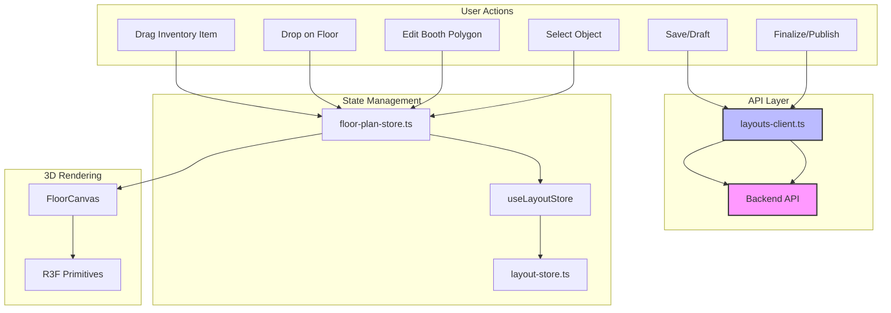

# Design Document: Admin Floor Plan Builder

## Overview

The Admin Floor Plan Builder is a dedicated 3D floor planning interface for venue administrators. It enables creation, editing, and management of 3D booth layouts with polygon-shaped (non-rectangular) booths, drag-and-drop inventory management, and dynamic visual feedback. This feature extends the existing building schema and layout editor infrastructure while maintaining separation from visitor-facing views.

### Design Principles

1. **Extensibility**: Leverage existing `building-schema.ts` and layout editor patterns
2. **Backend Compatibility**: Use existing `/api/events/:eventId/layout` and `/api/events/:eventId/layout/draft` endpoints
3. **Schema Alignment**: Extend existing floorAuthoringSchema for all object types
4. **Consistency**: Follow existing code organization (features/building, features/layout-editor)
5. **Performance**: Maintain 60 FPS with complex layouts (50+ objects)
6. **Procedural Rendering**: Use R3F primitives for Phase 1 - defer realistic objects to later phases
7. **Data Persistence**: Auto-save with debouncing and error recovery
8. **Shortcut Parity**: Preserve all existing keyboard shortcuts from demo

## Architecture

### Backend API Integration

The Admin Floor Plan Builder uses existing backend API endpoints from `src/features/building/api/layouts-client.ts`:

**Existing Endpoints:**
- `PUT /api/events/:eventId/layout` - Save/publish layout
  - Returns: `{ saved: boolean }`
  - Header: `X-Venue-Version` for optimistic concurrency control
  - Authorization: `venueAuthorizationHeaders()`
  
- `PUT /api/events/:eventId/layout/draft` - Save draft layout
  - Returns: `{ saved: boolean }`
  - Authorization: `venueAuthorizationHeaders()`
  
- `GET /api/events/:eventId/layout` - Load published layout
  - Returns: BuildingLayout
  - Header: `X-Venue-Version` in response
  
- `GET /api/events/:eventId/layout/draft` - Load draft layout
  - Returns: BuildingLayout | null
  - Authorization: `venueAuthorizationHeaders()`

**Version Management:**
- `loadedVersions` Map tracks accepted revision for each event
- `responseVersions` WeakMap maps layouts to their version metadata
- Draft saves advance the expected revision on success
- Layout loads use generation counter to ignore stale responses

### High-Level Structure

```
src/features/
├── floor-plan-builder/
│   ├── api/                      # API clients (reuse building API)
│   │   └── index.ts              # Re-exports from building/api
│   ├── components/               # UI Components
│   │   ├── AdminFloorPlanPage.tsx
│   │   ├── FloorCanvas.tsx       # Main 3D canvas component
│   │   ├── InventorySidebar.tsx  # Drag-and-drop inventory sidebar
│   │   ├── BoothEditor.tsx       # Polygon booth editor
│   │   └── FloorSelector.tsx
│   ├── hooks/                    # Custom hooks
│   │   ├── use-floor-manager.ts
│   │   ├── use-inventory-drag.ts
│   │   └── use-booth-editor.ts
│   ├── model/                    # State management and logic
│   │   ├── floor-plan-store.ts   # Zustand store for floor plan state
│   │   ├── object-types.ts       # Object type definitions
│   │   ├── validation.ts         # Validation logic
│   │   └── utils.ts              # Utility functions
│   └── types/                    # TypeScript types
│       └── floor-plan-types.ts
└── building/
    └── api/                      # Reused API clients
        ├── layouts-client.ts     # Backend API integration
        └── dto.ts                # Request/response schemas
```

### Component Hierarchy

```
AdminFloorPlanPage
├── FloorSelector (top bar)
├── InventorySidebar (left sidebar)
│   ├── InventoryCategory (booths, stairs, tents, amenities)
│   │   └── InventoryItem (draggable)
├── MainCanvasContainer
│   └── FloorCanvas (R3F Canvas)
│       ├── FloorBackground
│       ├── WalkableZones
│       ├── BoothInstances
│       │   └── Booth (polygon-shaped)
│       ├── OtherObjects
│       │   ├── Stairs
│       │   ├── Tents
│       │   ├── Washrooms
│       │   ├── KidsZone
│       │   └── Avatars (R3F primitives: cylinder for body, box for head)
│       ├── DragGhost (during drag operations)
│       └── SelectionHighlight (selected object)
└── ValidationPanel (bottom)
    ├── ErrorList
    ├── ValidationSummary
    └── SaveStatus
```

### Data Flow



## Components and Interfaces

### API Client Integration

**Reusing Existing Building API**

The Admin Floor Plan Builder reuses the API clients from `src/features/building/api/`:

```typescript
// src/features/floor-plan-builder/api/index.ts
export {
  getLayout,
  saveLayout,
  getLayoutDraft,
  saveLayoutDraft,
  acceptedLayoutVersion,
  acceptLayoutVersion,
} from '@/features/building/api/layouts-client.ts';

export type { DraftLayoutResponse, SaveLayoutResponse } from '@/features/building/api/dto.ts';
```

**API Function Signatures:**

```typescript
// Get published layout
export async function getLayout(
  eventId: string,
  config?: AxiosRequestConfig,
): Promise<Result<BuildingLayout, ApiError>>

// Save/publish layout
export async function saveLayout(
  eventId: string,
  layout: BuildingLayout,
): Promise<Result<{ saved: boolean }, ApiError>>

// Get draft layout
export function getLayoutDraft(
  eventId: string,
  config?: AxiosRequestConfig,
): Promise<Result<BuildingLayout | null, ApiError>>

// Save draft layout
export function saveLayoutDraft(
  eventId: string,
  layout: BuildingLayout,
): Promise<Result<{ saved: boolean }, ApiError>>

// Version management
export function acceptedLayoutVersion(eventId: string): number
export function acceptLayoutVersion(eventId: string, layout: BuildingLayout): void
```

**Usage in Components:**

```typescript
// Auto-save draft
async function autoSaveDraft(layout: BuildingLayout) {
  const result = await saveLayoutDraft(eventId, layout);
  if (result.isOk()) {
    // Draft saved successfully
    // The backend validates and stores the layout
  } else {
    // Handle error - network failure, version conflict, etc.
    console.error('Draft save failed:', result.error);
  }
}

// Finalize/publish layout
async function finalizeLayout(layout: BuildingLayout) {
  // Get current accepted version for concurrency control
  const version = acceptedLayoutVersion(eventId);
  
  const result = await saveLayout(eventId, layout);
  if (result.isOk() && result.value.saved) {
    // Accept the new version
    acceptLayoutVersion(eventId, layout);
    // Layout published successfully
  } else {
    // Handle error or no change
  }
}
```

### Polygon Geometry Specification

**Storage Model:**

The polygon geometry uses unique vertices with implicit closure:

```typescript
// Store unique vertices - first and last points are the same (closed polygon)
// Example: square with vertices at corners
type Polygon = [number, number][]; // Array of [x, z] coordinates in meters

// Valid polygon (closed square):
const validPolygon: Polygon = [
  [0, 0],  // vertex 0
  [5, 0],  // vertex 1
  [5, 5],  // vertex 2
  [0, 5],  // vertex 3
  [0, 0],  // closing vertex (same as first)
];

// Validation rules:
// 1. Minimum 3 unique vertices (4 points including closing vertex)
// 2. First and last points must match (within epsilon 0.001)
// 3. Must be simple (no self-intersections)
// 4. Must have positive area (>= 0.01 square meters)
// 5. No consecutive duplicate vertices
```

**Coordinate Systems:**

```typescript
// Source Coordinates (pixels) - from floor image
interface SourceCoordinates {
  units: 'pixels';
  metersPerPixel: number; // calibration factor
  origin: [number, number]; // image origin in source units
  // Optional basis matrix for non-aligned coordinate systems
  basis?: [number, number, number, number];
}

// World Meters - for 3D rendering and collision detection
interface WorldCoordinates {
  units: 'meters';
}

// Conversion utilities from src/features/building/model/floor-coordinates.ts:
export function sourceToMetres(
  point: [number, number],
  calibration?: SourceCoordinates
): [number, number] {
  // Converts source coordinates to world meters
  // Handles pixel-to-meter conversion via metersPerPixel
  // Applies origin offset
  // Uses basis matrix if present for rotated coordinate systems
}

export function metresToSource(
  point: [number, number],
  calibration?: SourceCoordinates
): [number, number] {
  // Converts world meters to source coordinates
  // Inverse operation of sourceToMetres
}
```

**Rotation and Scaling:**

```typescript
// Booth/Instance rotation (yaw)
interface Rotatable {
  yawRadians: number; // Rotation around Y-axis in radians
  // Positive = counter-clockwise when viewed from above
  // 0 radians = facing +Z direction
}

// Scaling
interface Scalable {
  scale: [number, number, number]; // [x, y, z] scale factors
  // 1.0 = original size
  // >1.0 = larger
  // <1.0 = smaller
}
```

**Resize Behavior:**

```typescript
// When resizing a polygon:
// 1. Calculate new vertices based on resize handles
// 2. Validate the new polygon (simple, closed, positive area)
// 3. Update position to maintain center point if resizing around center
// 4. Preserve aspect ratio if shift key is held
// 5. Snap to grid if snap is enabled

function resizePolygon(
  polygon: Polygon,
  resizeHandle: number, // Index of handle being dragged
  newPosition: [number, number],
  options?: {
    preserveCenter?: boolean;
    preserveAspect?: boolean;
    snap?: number; // Snap to grid size in meters
  }
): Polygon {
  // Implementation
}
```

## Data Models

### Core TypeScript Interfaces (floor-plan-types.ts)

**Object Type Definitions**

```typescript
// Object types supported by the floor plan builder
export const FLOOR_PLAN_OBJECT_TYPES = [
  'booth',
  'stairs',
  'tent',
  'washroom',
  'kids-zone',
  'avatar',
  'entrance',
] as const;

export type FloorPlanObjectType = (typeof FLOOR_PLAN_OBJECT_TYPES)[number];

// Base object definition - aligns with floorAuthoringSchema.instances
export interface FloorPlanObject {
  id: string;
  type: FloorPlanObjectType;
  position: [number, number]; // x, z in meters (world coordinates)
  yawRadians: number;
  scale: [number, number, number];
  floorId: string;
  // Required by backend schema: either assetId or url must be present
  assetId?: string;
  url?: string;
  dimensions: [number, number, number]; // Required by backend schema
  collidable: boolean; // Required by backend schema
}

// Polynomial booth - extends room schema with additional editing data
export interface BoothObject extends FloorPlanObject {
  type: 'booth';
  polygon: [number, number][]; // Array of unique vertices with implicit closure
  originalPolygon: [number, number][]; // For undo/redo
  isEditing: boolean;
  isPreview: boolean;
}

// Stairs object - represents multi-step staircase
export interface StairsObject extends FloorPlanObject {
  type: 'stairs';
  steps: number;
  tread: number; // Depth of each step in meters
  rise: number;  // Height of each step in meters
  connectsFloorIds: [string, string]; // Start and end floors
  width: number;
}

// Tent object - represents different tent styles
export interface TentObject extends FloorPlanObject {
  type: 'tent';
  width: number;  // Base width in meters
  depth: number;  // Base depth in meters
  height: number; // Peak height in meters
  style: 'barn' | 'gazebo' | 'marquee';
}

// Amenity object - washroom, kids zone, entrance, avatar
export interface AmenityObject extends FloorPlanObject {
  type: 'washroom' | 'kids-zone' | 'entrance' | 'avatar';
  label: string;
  gender?: 'men' | 'women' | 'unisex'; // Only for washrooms
}
```

**State Management Types**

```typescript
// Floor plan state
export interface FloorPlanState {
  layout: BuildingLayout;
  currentFloorId: string;
  selectedObjectId: string | null;
  isDragActive: boolean;
  dragInventory: InventoryDrag | null;
  dragPosition: [number, number] | null;
  isDirty: boolean;
  lastSavedAt: Date | null;
  validationErrors: FloorPlanValidationError[];
  unsavedChanges: boolean;
  // Per-floor undo/redo stacks
  floorHistory: Record<string, HistoryState>;
}

// Per-floor history state
export interface HistoryState {
  undoStack: BuildingLayout[];
  redoStack: BuildingLayout[];
}

// Validation error
export interface FloorPlanValidationError {
  id: string;
  type: 'collision' | 'invalid-polygon' | 'missing-field' | 'network';
  message: string;
  relatedIds: string[];
  severity: 'error' | 'warning';
}
```

### Zod Schemas

**Object Schemas - Extending floorAuthoringSchema**

```typescript
import { z } from 'zod';
import {
  buildingLayoutSchema,
  floorAuthoringSchema,
  roomSchema,
  point2Schema,
  assetReferenceSchema,
  runtimeAssetUrlSchema,
  finiteNumberSchema,
} from '@/features/building/model/building-schema.ts';
import { isSimplePolygon } from '@/utils/geometry/polygon.ts';

// Helper: polygon with minimum 3 unique vertices and implicit closure
export const polygonSchema = z
  .array(point2Schema)
  .min(3, 'Polygon must have at least 3 unique vertices')
  .refine(
    (points) => {
      // Remove consecutive duplicates
      const uniquePoints = points.filter((p, i, arr) => {
        const prev = arr[i - 1];
        return !prev || Math.abs(p[0] - prev[0]) > 0.001 || Math.abs(p[1] - prev[1]) > 0.001;
      });
      // Ensure polygon is closed (first and last point are the same)
      if (uniquePoints.length < 3) return false;
      const first = uniquePoints[0]!;
      const last = uniquePoints[uniquePoints.length - 1]!;
      return Math.abs(first[0] - last[0]) < 0.001 && Math.abs(first[1] - last[1]) < 0.001;
    },
    'Polygon must be closed (first and last points must match)',
  )
  .refine(isSimplePolygon, 'Polygon must be simple (no self-intersections)')
  .refine(
    (points) => {
      // Calculate signed area to ensure positive area
      let area = 0;
      for (let i = 0; i < points.length - 1; i++) {
        const [x1, y1] = points[i]!;
        const [x2, y2] = points[i + 1]!;
        area += x1 * y2 - x2 * y1;
      }
      return Math.abs(area) > 0.02; // Minimum 0.01 square meters
    },
    'Polygon must have positive area',
  );

// Booth object - extends room schema with editing metadata
export const boothSchema = roomSchema
  .pick({
    id: true,
    floorId: true,
    polygon: true,
    type: true,
  })
  .extend({
    position: point2Schema,
    yawRadians: finiteNumberSchema,
    scale: z.tuple([finiteNumberSchema.positive(), finiteNumberSchema.positive(), finiteNumberSchema.positive()]),
    // Required by backend schema: assetId or url
    assetId: z.string().optional(),
    url: runtimeAssetUrlSchema.optional(),
    dimensions: z.tuple([
      finiteNumberSchema.positive(),
      finiteNumberSchema.positive(),
      finiteNumberSchema.positive(),
    ]),
    collidable: z.boolean(),
    // Editing-specific fields
    originalPolygon: z.array(point2Schema),
    isEditing: z.boolean().default(false),
    isPreview: z.boolean().default(false),
  });

// Stairs object - extends instance schema
export const stairsSchema = z.object({
  id: z.string().min(1),
  assetId: z.string().optional(),
  url: runtimeAssetUrlSchema.optional(),
  position: point2Schema,
  yawRadians: finiteNumberSchema,
  scale: z.tuple([finiteNumberSchema.positive(), finiteNumberSchema.positive(), finiteNumberSchema.positive()]),
  floorId: z.string().min(1),
  dimensions: z.tuple([
    finiteNumberSchema.positive(),
    finiteNumberSchema.positive(),
    finiteNumberSchema.positive(),
  ]),
  collidable: z.boolean(),
  type: z.literal('stairs'),
  steps: z.number().min(1),
  tread: z.number().min(0.1),
  rise: z.number().min(0.1),
  connectsFloorIds: z.tuple([z.string(), z.string()]),
  width: z.number().min(0.5),
});

// Tent object - extends instance schema
export const tentSchema = z.object({
  id: z.string().min(1),
  assetId: z.string().optional(),
  url: runtimeAssetUrlSchema.optional(),
  position: point2Schema,
  yawRadians: finiteNumberSchema,
  scale: z.tuple([finiteNumberSchema.positive(), finiteNumberSchema.positive(), finiteNumberSchema.positive()]),
  floorId: z.string().min(1),
  dimensions: z.tuple([
    finiteNumberSchema.positive(),
    finiteNumberSchema.positive(),
    finiteNumberSchema.positive(),
  ]),
  collidable: z.boolean(),
  type: z.literal('tent'),
  width: z.number().min(1),
  depth: z.number().min(1),
  height: z.number().min(1),
  style: z.enum(['barn', 'gazebo', 'marquee']),
});

// Amenity object - extends instance schema
export const amenitySchema = z.discriminatedUnion('type', [
  z.object({
    id: z.string().min(1),
    assetId: z.string().optional(),
    url: runtimeAssetUrlSchema.optional(),
    position: point2Schema,
    yawRadians: finiteNumberSchema,
    scale: z.tuple([finiteNumberSchema.positive(), finiteNumberSchema.positive(), finiteNumberSchema.positive()]),
    floorId: z.string().min(1),
    dimensions: z.tuple([
      finiteNumberSchema.positive(),
      finiteNumberSchema.positive(),
      finiteNumberSchema.positive(),
    ]),
    collidable: z.boolean(),
    type: z.literal('washroom'),
    label: z.string().min(1),
    gender: z.enum(['men', 'women', 'unisex']).optional(),
  }),
  z.object({
    id: z.string().min(1),
    assetId: z.string().optional(),
    url: runtimeAssetUrlSchema.optional(),
    position: point2Schema,
    yawRadians: finiteNumberSchema,
    scale: z.tuple([finiteNumberSchema.positive(), finiteNumberSchema.positive(), finiteNumberSchema.positive()]),
    floorId: z.string().min(1),
    dimensions: z.tuple([
      finiteNumberSchema.positive(),
      finiteNumberSchema.positive(),
      finiteNumberSchema.positive(),
    ]),
    collidable: z.boolean(),
    type: z.literal('kids-zone'),
    label: z.string().min(1),
  }),
  z.object({
    id: z.string().min(1),
    assetId: z.string().optional(),
    url: runtimeAssetUrlSchema.optional(),
    position: point2Schema,
    yawRadians: finiteNumberSchema,
    scale: z.tuple([finiteNumberSchema.positive(), finiteNumberSchema.positive(), finiteNumberSchema.positive()]),
    floorId: z.string().min(1),
    dimensions: z.tuple([
      finiteNumberSchema.positive(),
      finiteNumberSchema.positive(),
      finiteNumberSchema.positive(),
    ]),
    collidable: z.boolean(),
    type: z.literal('entrance'),
    label: z.string().min(1),
  }),
  z.object({
    id: z.string().min(1),
    assetId: z.string().optional(),
    url: runtimeAssetUrlSchema.optional(),
    position: point2Schema,
    yawRadians: finiteNumberSchema,
    scale: z.tuple([finiteNumberSchema.positive(), finiteNumberSchema.positive(), finiteNumberSchema.positive()]),
    floorId: z.string().min(1),
    dimensions: z.tuple([
      finiteNumberSchema.positive(),
      finiteNumberSchema.positive(),
      finiteNumberSchema.positive(),
    ]),
    collidable: z.boolean(),
    type: z.literal('avatar'),
    label: z.string().min(1),
  }),
]);

// Floor plan object - union of all object types
export const floorPlanObjectSchema = z.discriminatedUnion('type', [
  boothSchema,
  stairsSchema,
  tentSchema,
  amenitySchema,
]);

export type FloorPlanObject = z.infer<typeof floorPlanObjectSchema>;
```

### Validation Constants

```typescript
export const VALIDATION_RULES = {
  // Polygon validation
  minVertices: 3,
  maxVertices: 20,
  minArea: 0.01, // square meters
  
  // Object placement
  minSpacing: 0.5, // meters
  maxObjectsPerFloor: 200,
  
  // Dimensions
  minBoothSize: [1.0, 1.0], // meters
  maxBoothSize: [10.0, 10.0], // meters
  
  // Performance
  maxTotalVertices: 10000,
  maxDrawCalls: 100,
};
```

## Correctness Properties

*A property is a characteristic or behavior that should hold true across all valid executions of a system-essentially, a formal statement about what the system should do. Properties serve as the bridge between human-readable specifications and machine-verifiable correctness guarantees.*

### Property 1: Polygon validity preservation

*For any* booth object, after creating or editing its polygon, the resulting polygon must be simple (non-self-intersecting), closed (first and last points match), and have positive area.

**Validates: Requirements 3.1, 4.2**

### Property 2: Object placement collision avoidance

*For any* set of objects on a floor, no two objects should have overlapping bounding boxes when placed with the minimum spacing of 0.5 meters.

**Validates: Requirements 4.3**

### Property 3: Validation accuracy

*For any* floor plan layout, the validation function should produce exactly the same errors as a manual inspection by an expert validator.

**Validates: Requirements 5.1, 5.2**

### Property 4: Save/load data integrity (Round-trip)

*For any* valid floor plan layout, saving to the backend and reloading should produce an equivalent layout with all data preserved.

**Validates: Requirements 6.1, 6.2**

### Property 5: Drag-and-drop object creation

*For any* inventory item dropped on a floor, a new object should be created with the correct type, position, and default properties, and the object count should increase by exactly one.

**Validates: Requirements 7.1, 7.2**

### Property 6: Undo/redo consistency

*For any* sequence of edit operations on a booth polygon, undoing the last operation should restore the polygon to its state before that operation.

**Validates: Requirements 4.1**

### Property 7: Selection persistence

*For any* selected object, the selection should persist through all state updates that don't explicitly change the selection, and deselecting should clear the selection without side effects.

**Validates: Requirements 8.1**

## Error Handling

### Validation Error Handling

**Polygon Validation Errors**

```typescript
export function validateBoothPolygon(polygon: [number, number][]): string | null {
  // Check if polygon is closed (first and last point are the same)
  const isClosed = polygon.length >= 3 && 
    Math.abs(polygon[0][0] - polygon[polygon.length - 1][0]) < 0.001 &&
    Math.abs(polygon[0][1] - polygon[polygon.length - 1][1]) < 0.001;
  
  if (!isClosed) {
    return 'Polygon must be closed (first and last points must match)';
  }
  
  // Check if polygon is simple (no self-intersections)
  if (!isSimplePolygon(polygon)) {
    return 'Polygon must be simple (no self-intersections)';
  }
  
  // Check if polygon has positive area
  const area = Math.abs(signedArea(polygon));
  if (area < 0.01) {
    return 'Polygon must have positive area';
  }
  
  return null;
}
```

**Object Placement Validation Errors**

```typescript
export function validateObjectPlacement(
  newObject: FloorPlanObject,
  existingObjects: FloorPlanObject[]
): string | null {
  // Check for collisions with existing objects
  for (const existing of existingObjects) {
    if (existing.id === newObject.id) continue;
    
    // Simple bounding box collision detection
    const dx = Math.abs(newObject.position[0] - existing.position[0]);
    const dz = Math.abs(newObject.position[1] - existing.position[1]);
    
    // Assuming each object has a collision radius/box
    if (dx < 1.0 && dz < 1.0) {
      return `Object collides with ${existing.type} at (${existing.position[0]}, ${existing.position[1]})`;
    }
  }
  
  return null;
}
```

### Network Error Handling

**API Error Responses**

```typescript
export function saveFloorPlan(
  layout: BuildingLayout,
  config?: AxiosRequestConfig,
): Promise<Result<void, ApiError>> {
  return apiResultValidated(
    `${apiBaseUrl()}/api/floor-plans/save`,
    z.undefined(),
    { method: 'POST', data: layout, ...config },
  );
}

export function loadFloorPlan(
  buildingId: string,
  config?: AxiosRequestConfig,
): Promise<Result<BuildingLayout, ApiError>> {
  return apiResultValidated(
    `${apiBaseUrl()}/api/floor-plans/${buildingId}`,
    buildingLayoutSchema,
    { method: 'GET', ...config },
  );
}
```

**Error Recovery Strategy**

```typescript
async function saveFloorPlan(layout: BuildingLayout): Promise<void> {
  try {
    const result = await apiClient.saveFloorPlan(layout);
    
    if (result.isErr()) {
      const error = result.error;
      throw new Error(error.message || 'Failed to save floor plan');
    }
  } catch (error) {
    console.error('Failed to save floor plan:', error);
    // Auto-save will retry on next idle period
    // User can manually retry save
    throw error;
  }
}
```

### User Feedback for Errors

**Error Display Component**

```typescript
function ErrorDisplay({ errors }: { errors: FloorPlanValidationError[] }) {
  if (errors.length === 0) {
    return null;
  }
  
  return (
    <div className="bg-red-50 border border-red-200 rounded-lg p-4">
      <h3 className="text-red-800 font-semibold mb-2">
        {errors.length} Validation Error{errors.length > 1 ? 's' : ''}
      </h3>
      <ul className="text-red-700 text-sm">
        {errors.map((error) => (
          <li key={error.id} className="mb-1">
            {error.severity === 'error' ? '⚠️' : '💡'} {error.message}
          </li>
        ))}
      </ul>
    </div>
  );
}
```

**Validation Summary**

```typescript
function ValidationSummary({ errors }: { errors: FloorPlanValidationError[] }) {
  const errorCount = errors.filter(e => e.severity === 'error').length;
  const warningCount = errors.filter(e => e.severity === 'warning').length;
  
  if (errorCount === 0 && warningCount === 0) {
    return <span className="text-green-600">No errors</span>;
  }
  
  return (
    <div className="flex items-center space-x-4">
      {errorCount > 0 && (
        <span className="text-red-600">⚠️ {errorCount} error{errorCount > 1 ? 's' : ''}</span>
      )}
      {warningCount > 0 && (
        <span className="text-yellow-600">💡 {warningCount} warning{warningCount > 1 ? 's' : ''}</span>
      )}
    </div>
  );
}
```

### Error Types and Recovery

| Error Type | Severity | User Action | System Recovery |
|------------|----------|-------------|-----------------|
| Collision | Error | Reposition object | Auto-highlights conflicting objects |
| Invalid Polygon | Error | Edit vertices | Shows error on invalid vertices |
| Missing Field | Error | Fill required fields | Highlights missing fields |
| Network | Error | Retry save | Local cache preserved for retry |
| Serialization | Error | Report bug | Logs detailed error for debugging |

### Validation Pipeline

```typescript
function validateFloorPlan(layout: BuildingLayout): FloorPlanValidationError[] {
  const errors: FloorPlanValidationError[] = [];
  
  // Validate each floor
  for (const floor of layout.floors) {
    const instances = floor.authoring?.instances ?? [];
    
    // Validate each instance
    for (const instance of instances) {
      // Check for required fields
      if (!instance.position || !instance.id) {
        errors.push({
          id: instance.id,
          type: 'missing-field',
          message: `Missing required field for ${instance.id}`,
          relatedIds: [instance.id],
          severity: 'error',
        });
        continue;
      }
      
      // Check for collisions
      for (const other of instances) {
        if (other.id === instance.id) continue;
        
        if (checkCollision(instance, other)) {
          errors.push({
            id: instance.id,
            type: 'collision',
            message: `Object collides with ${other.id}`,
            relatedIds: [instance.id, other.id],
            severity: 'error',
          });
        }
      }
    }
    
    // Validate polygon booths
    for (const room of layout.rooms) {
      if (room.floorId === floor.id) {
        const polygonError = validateBoothPolygon(room.polygon);
        if (polygonError) {
          errors.push({
            id: room.id,
            type: 'invalid-polygon',
            message: polygonError,
            relatedIds: [room.id],
            severity: 'error',
          });
        }
      }
    }
  }
  
  return errors;
}
```

### Keyboard Shortcuts Integration

**Existing Shortcut Handler (from FloorPlanEditor.tsx)**

The Admin Floor Plan Builder preserves all existing keyboard shortcuts from the demo. The existing handler in `src/features/layout-editor/components/FloorPlanEditor.tsx` already implements:

```typescript
// Reference: src/features/layout-editor/components/FloorPlanEditor.tsx line ~106
const key = useCallback((event: KeyboardEvent) => {
  // Input-focus guard - only process shortcuts when not typing
  if (isEditableTarget(event.target)) {
    return;
  }
  
  // Ctrl/Cmd+Z - undo
  if ((event.metaKey || event.ctrlKey) && event.key.toLowerCase() === 'z') {
    event.preventDefault();
    if (event.shiftKey) {
      useLayoutStore.getState().redo();
    } else {
      useLayoutStore.getState().undo();
    }
  }
  
  // Shift+S - save draft
  if (event.shiftKey && event.key.toLowerCase() === 's') {
    event.preventDefault();
    saveDraft();
  }
  
  // Shift+R - reload layout
  if (event.shiftKey && event.key.toLowerCase() === 'r') {
    event.preventDefault();
    reloadLayout();
  }
  
  // Shift+M - toggle move mode
  if (event.shiftKey && event.key.toLowerCase() === 'm') {
    event.preventDefault();
    toggleMoveMode();
  }
  
  // Shift+D - duplicate selected object
  if (event.shiftKey && event.key.toLowerCase() === 'd') {
    event.preventDefault();
    duplicateSelected();
  }
  
  // Shift+B - toggle booth selection mode
  if (event.shiftKey && event.key.toLowerCase() === 'b') {
    event.preventDefault();
    toggleBoothSelection();
  }
  
  // Shift+P - toggle placement mode
  if (event.shiftKey && event.key.toLowerCase() === 'p') {
    event.preventDefault();
    togglePlacementMode();
  }
  
  // Shift+T - toggle text input mode
  if (event.shiftKey && event.key.toLowerCase() === 't') {
    event.preventDefault();
    toggleTextMode();
  }
  
  // Shift+I - toggle inventory sidebar
  if (event.shiftKey && event.key.toLowerCase() === 'i') {
    event.preventDefault();
    toggleSidebar();
  }
  
  // Shift+Z - per-floor undo
  if (event.shiftKey && event.key.toLowerCase() === 'z') {
    event.preventDefault();
    floorUndo();
  }
  
  // Shift+X - per-floor redo
  if (event.shiftKey && event.key.toLowerCase() === 'x') {
    event.preventDefault();
    floorRedo();
  }
  
  // Space - pan mode
  if (event.code === 'Space') {
    setPanning(true);
  }
}, []);
```

**isEditableTarget Check:**

The existing `isEditableTarget` function from the layout editor:

```typescript
function isEditableTarget(target: EventTarget | null): boolean {
  // Check if target is an input element
  if (target instanceof HTMLInputElement || target instanceof HTMLTextAreaElement) {
    return true;
  }
  // Check if target is a contenteditable element
  if (target instanceof HTMLElement && target.isContentEditable) {
    return true;
  }
  // Check if target is a select element
  if (target instanceof HTMLSelectElement) {
    return true;
  }
  return false;
}
```

**POI Move/Duplicate Behavior:**

When moving or duplicating POIs (Points of Interest):

```typescript
function movePOI(id: string, delta: [number, number]) {
  // Get current POI position
  const poi = authoring().pois?.find((p) => p.id === id);
  if (!poi) return;
  
  // Check if this is during a drag operation
  if (isDragActive) {
    // Update position during drag
    updatePOIPosition(id, [
      poi.position[0] + delta[0],
      poi.position[1] + delta[1],
    ]);
  } else {
    // Finalize position on drag end
    commitPOIPosition(id, [
      poi.position[0] + delta[0],
      poi.position[1] + delta[1],
    ]);
  }
}

function duplicatePOI(id: string) {
  // Find original POI
  const original = authoring().pois?.find((p) => p.id === id);
  if (!original) return;
  
  // Create copy with new ID
  const copyId = `poi-${crypto.randomUUID()}`;
  patchAuthoring({
    pois: [
      ...(authoring().pois ?? []),
      {
        ...original,
        id: copyId,
        position: [
          original.position[0] + 0.5, // Offset slightly
          original.position[1] + 0.5,
        ],
      },
    ],
  });
}
```

**Floor-Change Guards:**

When switching floors:

```typescript
function switchFloor(floorId: string) {
  // Cancel any active drag operations
  cancelGesture();
  
  // Clear any temporary drawing points
  setPoints([]);
  
  // Deselect any selected objects
  setSelectedInstance('');
  setFeatureSelection(null);
  
  // Update state
  setFloorId(floorId);
}
```

**Per-Floor History:**

Each floor maintains its own undo/redo stack:

```typescript
interface HistoryState {
  undoStack: BuildingLayout[];
  redoStack: BuildingLayout[];
}

interface FloorPlanState {
  floorHistory: Record<string, HistoryState>;
}

function floorUndo(floorId: string): void {
  const history = state.floorHistory[floorId];
  if (!history || history.undoStack.length === 0) return;
  
  const currentLayout = state.layout;
  const previousLayout = history.undoStack.pop()!;
  
  // Push current to redo stack
  history.redoStack.push(currentLayout);
  
  // Update layout and history
  state.layout = previousLayout;
}

function floorRedo(floorId: string): void {
  const history = state.floorHistory[floorId];
  if (!history || history.redoStack.length === 0) return;
  
  const currentLayout = state.layout;
  const nextLayout = history.redoStack.pop()!;
  
  // Push current to undo stack
  history.undoStack.push(currentLayout);
  
  // Update layout and history
  state.layout = nextLayout;
}
```


### Real-time Validation Feedback

```typescript
function useRealtimeValidation() {
  const layout = useLayoutStore((s) => s.layout);
  const [validationErrors, setValidationErrors] = useState<FloorPlanValidationError[]>([]);
  
  useEffect(() => {
    const errors = validateFloorPlan(layout);
    setValidationErrors(errors);
  }, [layout]);
  
  return validationErrors;
}
```

### Procedural-Only Rendering (Phase 1)

**R3F Primitives for All Objects**

The Admin Floor Plan Builder uses only R3F primitives for Phase 1 rendering. All objects are generated programmatically without external GLB files.

**Object Types and Their Procedural Representations:**

```typescript
// Booth - extruded polygon
function Booth3D({ booth, floorColor, isSelected }: Booth3DProps) {
  // Create a tube geometry from polygon vertices
  const pathPoints = booth.polygon.map(([x, z]) => new Vector3(x, 0, z));
  pathPoints.push(pathPoints[0]); // Close the loop
  
  const tubeGeometry = new TubeGeometry(
    new CatmullRomCurve3(pathPoints),
    1, // segments
    0.1, // radius
    8, // radialSegments
    false // closed
  );
  
  return (
    <Mesh geometry={tubeGeometry} position={[booth.position[0], 0, booth.position[1]]}>
      <MeshStandardMaterial color={floorColor} />
      {isSelected && <Wireframe />}
    </Mesh>
  );
}

// Stairs - multiple stacked boxes
function Stairs3D({ stairs }: Stairs3DProps) {
  const stairComponents = [];
  
  for (let i = 0; i < stairs.steps; i++) {
    const stepHeight = i * stairs.rise;
    const stepDepth = i * stairs.tread;
    
    stairComponents.push(
      <Mesh
        key={i}
        geometry={new BoxGeometry(stairs.tread, stairs.rise, stairs.width)}
        position={[
          stairs.position[0] + stepDepth,
          stepHeight,
          stairs.position[1],
        ]}
      >
        <MeshStandardMaterial color="#8B7355" />
      </Mesh>
    );
  }
  
  return <Group>{stairComponents}</Group>;
}

// Tent - varies by style
function Tent3D({ tent }: Tent3DProps) {
  switch (tent.style) {
    case 'barn':
      return (
        <Group position={[tent.position[0], 0, tent.position[1]]}>
          {/* Main body */}
          <Mesh geometry={new BoxGeometry(tent.width, tent.height, tent.depth)}>
            <MeshStandardMaterial color="#E8D4B8" />
          </Mesh>
          {/* Roof */}
          <Mesh
            geometry={new ConeGeometry(tent.width / 2, tent.height * 0.3, 4)}
            position={[0, tent.height, 0]}
            rotation={[Math.PI / 2, 0, 0]}
          >
            <MeshStandardMaterial color="#C6A488" />
          </Mesh>
        </Group>
      );
      
    case 'gazebo':
      return (
        <Group position={[tent.position[0], 0, tent.position[1]]}>
          {/* Columns */}
          {[[-1, -1], [1, -1], [1, 1], [-1, 1]].map(([x, z], i) => (
            <Mesh
              key={i}
              geometry={new CylinderGeometry(0.1, 0.1, tent.height)}
              position={[x * (tent.width / 2), tent.height / 2, z * (tent.depth / 2)]}
            >
              <MeshStandardMaterial color="#654321" />
            </Mesh>
          ))}
          {/* Roof */}
          <Mesh geometry={new CylinderGeometry(tent.width / 2, tent.width / 2, 0.1)}>
            <MeshStandardMaterial color="#E8D4B8" />
          </Mesh>
        </Group>
      );
      
    case 'marquee':
      return (
        <Group position={[tent.position[0], 0, tent.position[1]]}>
          {/* Main structure */}
          <Mesh geometry={new BoxGeometry(tent.width, tent.height, tent.depth)}>
            <MeshStandardMaterial color="#FFFFFF" />
          </Mesh>
          {/* Roof peaks */}
          <Mesh
            geometry={new CapsuleGeometry(tent.width / 2, tent.height - tent.depth, 4, 8)}
            position={[0, tent.height, 0]}
            rotation={[Math.PI / 2, 0, 0]}
          >
            <MeshStandardMaterial color="#F5F5F5" />
          </Mesh>
        </Group>
      );
  }
}

// Amenity - varies by type
function Amenity3D({ amenity }: AmenityObject) {
  switch (amenity.type) {
    case 'washroom':
      return (
        <Group position={[amenity.position[0], 0, amenity.position[1]]}>
          {/* Building */}
          <Mesh geometry={new BoxGeometry(2, 2, 2)}>
            <MeshStandardMaterial color="#E0E0E0" />
          </Mesh>
          {/* Sign */}
          <Mesh
            geometry={new BoxGeometry(1, 0.3, 0.1)}
            position={[0, 2.2, 1.1]}
          >
            <MeshStandardMaterial color="#3498DB" />
          </Mesh>
        </Group>
      );
      
    case 'kids-zone':
      return (
        <Group position={[amenity.position[0], 0, amenity.position[1]]}>
          {/* Play area */}
          <Mesh
            geometry={new CylinderGeometry(3, 3, 0.1, 32)}
            rotation={[Math.PI / 2, 0, 0]}
          >
            <MeshStandardMaterial color="#90EE90" />
          </Mesh>
          {/* Slide */}
          <Mesh geometry={new CylinderGeometry(0.5, 0.5, 2)}>
            <MeshStandardMaterial color="#FF6B6B" />
          </Mesh>
        </Group>
      );
      
    case 'entrance':
      return (
        <Group position={[amenity.position[0], 0, amenity.position[1]]}>
          {/* Arch */}
          <Mesh geometry={new TorusGeometry(1, 0.2, 16, 100, Math.PI)}>
            <MeshStandardMaterial color="#4A90E2" />
          </Mesh>
          {/* Arrow */}
          <Mesh
            geometry={new ConeGeometry(0.3, 1, 8)}
            position={[0, 0.5, 1.2]}
            rotation={[Math.PI / 2, 0, 0]}
          >
            <MeshStandardMaterial color="#4A90E2" />
          </Mesh>
        </Group>
      );
      
    case 'avatar':
      // Standing person representation using R3F primitives
      return (
        <Group position={[amenity.position[0], 0, amenity.position[1]]}>
          {/* Legs */}
          <Mesh geometry={new CylinderGeometry(0.1, 0.1, 1.5)}>
            <MeshStandardMaterial color="#333333" />
          </Mesh>
          {/* Body */}
          <Mesh geometry={new CylinderGeometry(0.3, 0.3, 0.8)}>
            <MeshStandardMaterial color="#4A90E2" />
          </Mesh>
          {/* Head */}
          <Mesh geometry={new SphereGeometry(0.25)}>
            <MeshStandardMaterial color="#FFCCAA" />
          </Mesh>
        </Group>
      );
  }
}
```

**Deferred to Phase 2:**

Realistic objects with external GLB files are explicitly deferred:

- **Realistic booth interiors**: Detailed furniture, signage, lighting fixtures
- **Realistic amenity details**: Realistic fixtures, tiles, plumbing
- **Custom 3D models**: Brand-specific booth builds
- **High-fidelity textures**: Photorealistic materials and lighting

Phase 1 focuses on:
- Authoring system for layout creation
- Inventory definitions with procedural placeholders
- Drag-and-drop workflow
- Polygon editing and validation
- Backend API integration

### Testing Strategy

### Unit Tests

- **Validation**: Test polygon validation, collision detection, field validation
- **State management**: Test store actions and reducers
- **Components**: Test UI components in isolation

### Integration Tests

- **Drag and drop**: Test full drag-and-drop workflow
- **Object creation**: Test creating and placing objects
- **Validation flow**: Test validation error display and resolution

### Performance Tests

- **60 FPS**: Test rendering performance with 50+ objects
- **Save latency**: Test auto-save completes within 2 seconds
- **Load time**: Test floor plan loads within 2 seconds

### Property-Based Tests

- **Polygon operations**: Test that polygon operations preserve properties
- **Serialization round-trip**: Test that save/load preserves data
- **Validation consistency**: Test that validation rules are consistent

### Property-Based Testing Configuration

Each property-based test should:
- Run minimum 100 iterations
- Tag with feature name and property number
- Use a single property test per correctness property

Example tag format: `Feature: admin-floor-plan-builder, Property 1: Polygon validity preservation`

### Backend Integration Tests

- **API compatibility**: Test all endpoints use `/api/events/:eventId/layout` and `/api/events/:eventId/layout/draft`
- **Version handling**: Test `X-Venue-Version` header for concurrency control
- **Authorization**: Test `venueAuthorizationHeaders()` are included in all requests
- **Response format**: Test `{ saved: boolean }` response handling
- **Error scenarios**: Test 409, 412 conflict responses

## Future Enhancements

1. **Real-time collaboration**: Multiple admins working simultaneously
2. **Booth reservation workflow**: Integrate with existing booth reservation system
3. **Customer-facing previews**: Generate customer-facing views from floor plans
4. **Advanced analytics**: Track booth performance and utilization
5. **3D scanning**: Import physical venue scans for realistic base models
### Network Error Handling

**API Error Responses with Backend Integration**

```typescript
// Backend error response format
interface ApiError {
  status: number;
  message: string;
  details?: Record<string, unknown>;
}

// Save draft - handles draft version conflicts
export async function saveLayoutDraft(
  eventId: string,
  layout: BuildingLayout,
): Promise<Result<{ saved: boolean }, ApiError>> {
  const result = await apiResultValidated(
    `${apiBaseUrl()}/api/events/${encodeURIComponent(eventId)}/layout/draft`,
    saveLayoutResponseSchema,
    { method: 'PUT', data: layout, headers: venueAuthorizationHeaders() },
  );
  
  if (result.isErr()) {
    const error = result.error;
    // Backend may return 409 for version conflicts
    if (error.status === 409) {
      return err({
        status: 409,
        message: 'Draft version conflict. Please reload and reapply changes.',
        details: { eventId, timestamp: new Date().toISOString() },
      });
    }
    // Other network errors
    return err({
      status: error.status,
      message: error.message,
    });
  }
  
  return ok({ saved: result.value.saved });
}

// Save/publish layout - handles concurrent modifications
export async function saveLayout(
  eventId: string,
  layout: BuildingLayout,
): Promise<Result<{ saved: boolean }, ApiError>> {
  const version = loadedVersions.get(eventId) ?? 0;
  
  const result = await apiResultValidated(
    `${apiBaseUrl()}/api/events/${eventId}/layout`,
    saveLayoutResponseSchema,
    {
      method: 'PUT',
      data: layout,
      headers: { 
        ...venueAuthorizationHeaders(), 
        'X-Venue-Version': String(version) // Optimistic concurrency
      },
    },
  );
  
  if (result.isErr()) {
    const error = result.error;
    // 412 Precondition Failed = version conflict
    if (error.status === 412) {
      return err({
        status: 412,
        message: 'Layout has been modified by another user. Please reload.',
        details: { 
          eventId, 
          expectedVersion: version,
          currentTimestamp: new Date().toISOString() 
        },
      });
    }
    return err({
      status: error.status,
      message: error.message,
    });
  }
  
  // Update accepted version on success
  if (result.value.saved) {
    loadedVersions.set(eventId, version + 1);
  }
  
  return ok({ saved: result.value.saved });
}

// Load draft - handles missing drafts
export function getLayoutDraft(
  eventId: string,
  config?: AxiosRequestConfig,
): Promise<Result<BuildingLayout | null, ApiError>> {
  return apiResultValidated(
    `${apiBaseUrl()}/api/events/${encodeURIComponent(eventId)}/layout/draft`,
    draftLayoutResponseSchema,
    { ...config, headers: { ...config?.headers, ...venueAuthorizationHeaders() } },
  );
}

// Load layout - handles missing layouts
export async function getLayout(
  eventId: string,
  config?: AxiosRequestConfig,
): Promise<Result<BuildingLayout, ApiError>> {
  // ... existing implementation
}
```

**Error Recovery Strategy**

```typescript
// Auto-save with retry logic
const DEBOUNCE_DELAY = 2000; // 2 seconds
const MAX_RETRIES = 3;
const RETRY_DELAY = 1000; // 1 second

async function saveWithRetry(
  saveFn: () => Promise<Result<{ saved: boolean }, ApiError>>,
): Promise<void> {
  let retries = 0;
  
  while (retries < MAX_RETRIES) {
    try {
      const result = await saveFn();
      
      if (result.isOk()) {
        // Success
        return;
      }
      
      // Handle specific error types
      if (result.error.status === 409 || result.error.status === 412) {
        // Version conflict - reload and reapply
        console.warn('Version conflict detected, reloading layout...');
        const layoutResult = await getLayout(eventId);
        
        if (layoutResult.isOk() && layoutResult.value) {
          // Reapply local changes
          const rebuiltLayout = reapplyLocalChanges(
            layoutResult.value,
            localChanges
          );
          saveLayoutDraft(eventId, rebuiltLayout);
        }
        return;
      }
      
      // Network error - retry
      retries++;
      if (retries < MAX_RETRIES) {
        await new Promise((resolve) => setTimeout(resolve, RETRY_DELAY));
        continue;
      }
      
      // Max retries exceeded
      throw new Error(result.error.message || 'Failed to save layout');
      
    } catch (error) {
      retries++;
      if (retries < MAX_RETRIES) {
        await new Promise((resolve) => setTimeout(resolve, RETRY_DELAY));
        continue;
      }
      throw error;
    }
  }
}

// Local draft persistence for crash recovery
const DRAFT_STORAGE_KEY = 'floor-plan-draft';

function saveDraftToStorage(layout: BuildingLayout): void {
  try {
    localStorage.setItem(
      DRAFT_STORAGE_KEY,
      JSON.stringify({
        layout,
        timestamp: Date.now(),
        eventId,
      })
    );
  } catch (error) {
    console.error('Failed to save draft to local storage:', error);
  }
}

function loadDraftFromStorage(): BuildingLayout | null {
  try {
    const stored = localStorage.getItem(DRAFT_STORAGE_KEY);
    if (!stored) return null;
    
    const parsed = JSON.parse(stored);
    if (parsed.eventId !== eventId) return null;
    
    // Only accept drafts from last 24 hours
    if (Date.now() - parsed.timestamp > 24 * 60 * 60 * 1000) return null;
    
    return parsed.layout;
  } catch (error) {
    console.error('Failed to load draft from local storage:', error);
    return null;
  }
}

function clearDraftFromStorage(): void {
  try {
    localStorage.removeItem(DRAFT_STORAGE_KEY);
  } catch (error) {
    console.error('Failed to clear local storage draft:', error);
  }
}
```

### Real-time Validation Feedback

```typescript
function useRealtimeValidation() {
  const layout = useLayoutStore((s) => s.layout);
  const [validationErrors, setValidationErrors] = useState<FloorPlanValidationError[]>([]);
  
  useEffect(() => {
    const errors = validateFloorPlan(layout);
    setValidationErrors(errors);
  }, [layout]);
  
  return validationErrors;
}
```
### Backend Integration Tests

- **API compatibility**: Test all endpoints use `/api/events/:eventId/layout` and `/api/events/:eventId/layout/draft`
- **Version handling**: Test `X-Venue-Version` header for concurrency control
- **Authorization**: Test `venueAuthorizationHeaders()` are included in all requests
- **Response format**: Test `{ saved: boolean }` response handling
- **Error scenarios**: Test 409, 412 conflict responses

## Inventory Definitions

**Inventory Schema**

All inventory types must define a consistent schema:

```typescript
interface InventoryItem {
  id: string;
  name: string;
  category: 'booth' | 'stairs' | 'tent' | 'amenity';
  
  // Procedural geometry definition
  geometry: {
    type: 'box' | 'cylinder' | 'cone' | 'tube' | 'group';
    dimensions: [number, number, number];
    // Additional geometry-specific properties
    segments?: number;
    radialSegments?: number;
  };
  
  // Backend schema fields
  dimensions: [number, number, number]; // meters
  collidable: boolean;
  
  // Asset reference (optional - defaults to procedural)
  assetId?: string;
  url?: string;
  
  // Visual properties
  defaultColor?: string;
  defaultMaterial?: string;
  
  // Category-specific properties
  booth?: {
    shape: 'rectangle' | 'polygon';
    minDimensions: [number, number];
    maxDimensions: [number, number];
  };
  
  stairs?: {
    steps: number;
    tread: number;
    rise: number;
    width: number;
  };
  
  tent?: {
    styles: ('barn' | 'gazebo' | 'marquee')[];
    baseDimensions: [number, number, number];
  };
  
  amenity?: {
    type: 'washroom' | 'kids-zone' | 'entrance' | 'avatar';
    gender?: 'men' | 'women' | 'unisex';
  };
}

// Example inventory definitions
export const INVENTORY_ITEMS: InventoryItem[] = [
  {
    id: 'booth-standard',
    name: 'Standard Booth',
    category: 'booth',
    geometry: {
      type: 'box',
      dimensions: [3, 3, 3], // 3m x 3m
    },
    dimensions: [3, 3, 3],
    collidable: true,
    booth: {
      shape: 'rectangle',
      minDimensions: [2, 2],
      maxDimensions: [10, 10],
    },
  },
  {
    id: 'stairs-regular',
    name: 'Regular Stairs',
    category: 'stairs',
    geometry: {
      type: 'group',
      children: [
        {
          type: 'box',
          dimensions: [1, 0.3, 1], // Step geometry
        },
      ],
    },
    dimensions: [2, 4, 1], // Total dimensions
    collidable: true,
    stairs: {
      steps: 4,
      tread: 0.3,
      rise: 0.25,
      width: 1,
    },
  },
  {
    id: 'tent-barn',
    name: 'Barn Tent',
    category: 'tent',
    geometry: {
      type: 'group',
      children: [
        { type: 'box', dimensions: [5, 3, 4] }, // Main body
        { type: 'cone', dimensions: [3, 1.5, 3] }, // Roof
      ],
    },
    dimensions: [5, 3, 4],
    collidable: true,
    tent: {
      styles: ['barn', 'gazebo', 'marquee'],
      baseDimensions: [5, 3, 4],
    },
  },
  {
    id: 'amenity-washroom',
    name: 'Washroom',
    category: 'amenity',
    geometry: {
      type: 'box',
      dimensions: [3, 3, 3],
    },
    dimensions: [3, 3, 3],
    collidable: true,
    amenity: {
      type: 'washroom',
      gender: 'unisex',
    },
  },
  {
    id: 'avatar-standing',
    name: 'Standing Person',
    category: 'amenity',
    geometry: {
      type: 'group',
      children: [
        { type: 'cylinder', dimensions: [0.1, 0.1, 1.5] }, // Body
        { type: 'sphere', dimensions: [0.25, 0.25, 0.25] }, // Head
      ],
    },
    dimensions: [0.6, 1.75, 0.6],
    collidable: false,
    amenity: {
      type: 'avatar',
    },
  },
];
```

**Example Acceptance Scenarios:**

```typescript
// Placement scenario
test('Place inventory item on floor', async () => {
  // Given an inventory item
  const item = INVENTORY_ITEMS.find((i) => i.id === 'booth-standard')!;
  
  // When placed on floor
  const position: [number, number] = [5, 5];
  const yaw = Math.PI / 4;
  
  // Then a booth instance is created
  expect(layout.floors[0]!.authoring?.instances).toEqual(
    expect.arrayContaining([
      expect.objectContaining({
        id: expect.any(String),
        type: 'booth',
        position,
        yawRadians: yaw,
        dimensions: item.dimensions,
        collidable: item.collidable,
      }),
    ])
  );
});

// Movement scenario
test('Move inventory item', async () => {
  // Given an inventory item on floor
  const item = INVENTORY_ITEMS.find((i) => i.id === 'booth-standard')!;
  const initialPosition: [number, number] = [5, 5];
  
  // When moved
  const newItem = { ...item, position: [10, 10] };
  
  // Then position is updated
  expect(layout.floors[0]!.authoring?.instances.find((i) => i.id === newItem.id)!.position).toEqual(
    [10, 10]
  );
});

// Editing scenario
test('Edit inventory item properties', async () => {
  // Given an inventory item on floor
  const item = INVENTORY_ITEMS.find((i) => i.id === 'booth-standard')!;
  
  // When dimensions are changed
  const newItem = { ...item, dimensions: [4, 4, 4] };
  
  // Then dimensions are updated
  expect(layout.floors[0]!.authoring?.instances.find((i) => i.id === item.id)!.dimensions).toEqual(
    [4, 4, 4]
  );
});
```

## Future Enhancements

1. **Real-time collaboration**: Multiple admins working simultaneously
2. **Booth reservation workflow**: Integrate with existing booth reservation system
3. **Customer-facing previews**: Generate customer-facing views from floor plans
4. **Advanced analytics**: Track booth performance and utilization
5. **3D scanning**: Import physical venue scans for realistic base models
6. **Realistic rendering**: Phase 2 with external GLB files
7. **Advanced lighting**: Real-time lighting and shadow effects
8. **Audio integration**: Spatial audio for virtual venue tours